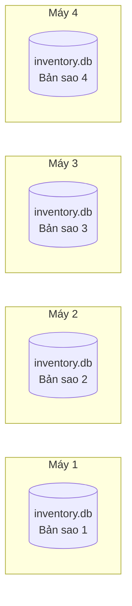
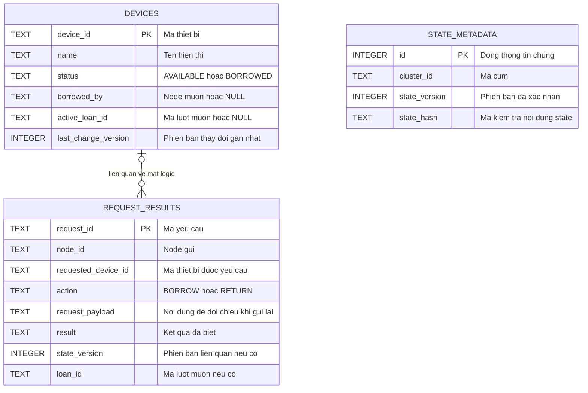

# Thiết kế đề xuất: Cơ sở dữ liệu kho thiết bị dùng chung

> Tài liệu phục vụ họp nhóm cho phần database. Đây là phương án đề xuất, chưa phải schema đã được duyệt hay triển khai.

## 1. Phạm vi và phương án lưu

Cơ sở dữ liệu lưu danh mục thiết bị, trạng thái mượn hiện tại và thông tin cần thiết để nhận diện phiên bản dữ liệu. Theo README, hệ thống có bốn node và không dùng một file database chung trên mạng. Đề xuất mỗi node lưu một bản sao cục bộ, có thể dùng SQLite; tên file ví dụ là `inventory.db`.

Bốn file cùng tên trên bốn máy vẫn là **bốn file riêng**. Mỗi file chứa bản sao của cùng một kho về mặt logic và có thể tạm thời cũ hơn bản sao khác. SQLite là lựa chọn để nhóm cân nhắc, chưa phải công nghệ đã chốt.

Sơ đồ chỉ mô tả **vị trí lưu**, không mô tả quá trình truyền hoặc đồng bộ dữ liệu. Nội dung và thứ tự lưu để hỗ trợ khôi phục cần được thống nhất với thành viên phụ trách thuật toán.

## 2. Các nhóm dữ liệu đề xuất

`PK` là khóa chính; `NULL` nghĩa là không có giá trị. Đường nối cho biết quan hệ về ý nghĩa dữ liệu, không áp đặt khóa ngoại: `requested_device_id` có thể là mã không tồn tại khi cần lưu kết quả `NOT_FOUND`. `STATE_METADATA` chứa thông tin chung của toàn bộ kho nên không liên kết với một thiết bị riêng.

README minh họa người mượn trong token bằng trường `by`; database đề xuất tên `borrowed_by`. Nhóm cần thống nhất một tên hoặc quy tắc ánh xạ giữa hai biểu diễn khi tích hợp.

Các bảng trên là đề xuất để trao đổi. Dữ liệu phục vụ giao thức phân tán, ví dụ epoch đã chấp nhận và thông tin cần để khôi phục, có thể cần các bảng hoặc cột riêng. **Chưa chốt schema phần đó** vì phụ thuộc giao thức và yêu cầu từ nhóm phụ trách thuật toán.

## 3. Bảng `devices` — trạng thái thiết bị hiện tại

Mỗi dòng đại diện cho một thiết bị vật lý cụ thể. Hai bộ Arduino cùng loại vẫn có hai mã khác nhau.

| Trường | Kiểu đề xuất | Ý nghĩa và lý do sử dụng |
|---|---|---|
| `device_id` | TEXT, khóa chính | Mã ổn định và duy nhất, ví dụ `DEV-01`; phân biệt thiết bị ngay cả khi tên trùng hoặc thay đổi. |
| `name` | TEXT, bắt buộc | Tên thiết bị để nhận biết, ví dụ `Máy chiếu Sony #01`. |
| `status` | TEXT, bắt buộc | Trạng thái hiện tại: `AVAILABLE` hoặc `BORROWED`. |
| `borrowed_by` | TEXT hoặc NULL | Định danh bên đang mượn; đề xuất dùng `node_id` cho demo, `NULL` khi chưa có người mượn. |
| `active_loan_id` | TEXT hoặc NULL | Mã lượt mượn hiện tại, giúp phân biệt các lần mượn khác nhau của cùng thiết bị. |
| `last_change_version` | INTEGER, bắt buộc | Phiên bản kho tại lần thay đổi gần nhất của thiết bị; hỗ trợ quan sát và đối chiếu dữ liệu. |

Ràng buộc dữ liệu đề xuất:

- `device_id` không rỗng, không trùng; `name` không rỗng.
- `status` chỉ nhận `AVAILABLE` hoặc `BORROWED`.
- `AVAILABLE` đi cùng `borrowed_by = NULL` và `active_loan_id = NULL`.
- `BORROWED` đi cùng `borrowed_by` và `active_loan_id` đều khác `NULL`.
- `last_change_version` không âm và không vượt phiên bản kho tương ứng.

Bảng lưu trạng thái hiện tại; không mặc định lưu đầy đủ lịch sử mượn/trả. Nếu nhóm cần lịch sử nghiệp vụ đầy đủ thì thiết kế thêm bảng riêng sau khi xác định yêu cầu.

### Dữ liệu khởi tạo

| device_id | name | status | borrowed_by | active_loan_id | last_change_version |
|---|---|---|---|---|---:|
| DEV-01 | Máy chiếu Sony #01 | AVAILABLE | NULL | NULL | 0 |
| DEV-02 | Kit Arduino #02 | AVAILABLE | NULL | NULL | 0 |
| DEV-03 | Kit Arduino #03 | AVAILABLE | NULL | NULL | 0 |

### Ví dụ một trạng thái sau khi đã xác nhận

| device_id | name | status | borrowed_by | active_loan_id | last_change_version |
|---|---|---|---|---|---:|
| DEV-01 | Máy chiếu Sony #01 | BORROWED | May_2 | loan-001 | 1 |
| DEV-02 | Kit Arduino #02 | AVAILABLE | NULL | NULL | 0 |
| DEV-03 | Kit Arduino #03 | AVAILABLE | NULL | NULL | 0 |

Đây là ảnh chụp minh họa một bản sao có phiên bản 1, không khẳng định mọi node đã cập nhật tại cùng thời điểm.

## 4. Bảng `state_metadata` — thông tin chung của kho

Đề xuất lưu một dòng metadata cho bản sao cục bộ:

| Trường | Kiểu đề xuất | Ý nghĩa |
|---|---|---|
| `id` | INTEGER, khóa chính | Định danh dòng metadata; có thể cố định bằng 1 khi chỉ có một kho. |
| `cluster_id` | TEXT, bắt buộc | Mã cụm, giúp phân biệt dữ liệu của các cấu hình chạy khác nhau. |
| `state_version` | INTEGER, bắt buộc | Phiên bản state đã xác nhận mà bản sao này lưu. Khởi tạo bằng 0. |
| `state_hash` | TEXT, bắt buộc | Giá trị hash của state đã chuẩn hóa, giúp phát hiện nội dung không khớp. |

Ví dụ: `id = 1`, `cluster_id = lab-demo-01`, `state_version = 1`, `state_hash = sha256:...`. Nhóm cần thống nhất cách sắp xếp trường và mã hóa trước khi tính hash. Hash chỉ hỗ trợ kiểm tra nội dung, không chứng minh state đã được xác nhận.

README dùng tên `state_version`; tài liệu này giữ tên đó. Nếu nhóm chọn `committed_version` thì cần thống nhất tên trong toàn bộ schema và thông điệp.

## 5. Bảng `request_results` — kết quả yêu cầu đã biết

Bảng này hỗ trợ lưu kết quả theo mã yêu cầu, để có thể đối chiếu khi cùng một yêu cầu được gửi lại. Đây không tự động là bảng lịch sử mượn/trả đầy đủ.

| Trường | Kiểu đề xuất | Ý nghĩa |
|---|---|---|
| `request_id` | TEXT, khóa chính | Mã duy nhất của yêu cầu. |
| `node_id` | TEXT, bắt buộc | Node tạo yêu cầu. |
| `requested_device_id` | TEXT, bắt buộc | Mã thiết bị được yêu cầu, kể cả mã không tồn tại. |
| `action` | TEXT, bắt buộc | `BORROW` hoặc `RETURN`. |
| `request_payload` | TEXT, bắt buộc | Nội dung yêu cầu ở dạng chuẩn hóa để nhận diện trường hợp cùng ID nhưng nội dung khác; định dạng cụ thể cần thống nhất. |
| `result` | TEXT, bắt buộc | Kết quả đã biết, ví dụ `SUCCESS`, `ALREADY_BORROWED`, `NOT_FOUND`. |
| `state_version` | INTEGER hoặc NULL | Phiên bản liên quan nếu kết quả gắn với một thay đổi đã xác nhận. |
| `loan_id` | TEXT hoặc NULL | Mã lượt mượn liên quan nếu có. |

Ví dụ:

| request_id | node_id | requested_device_id | action | result | state_version | loan_id |
|---|---|---|---|---|---:|---|
| req-001 | May_2 | DEV-01 | BORROW | SUCCESS | 1 | loan-001 |
| req-002 | May_3 | DEV-01 | BORROW | ALREADY_BORROWED | NULL | NULL |

Bảng ví dụ rút gọn không hiển thị `request_payload`. Nhóm cần thống nhất các kết quả nào được lưu, thời gian giữ dữ liệu và cơ chế bảo đảm khả năng tra cứu sau sự cố.

## 6. Cách lưu cục bộ và tính nhất quán của database

- Mỗi node có một file SQLite riêng; không cho các máy cùng mở một file qua thư mục mạng như một database dùng chung.
- Khi một thay đổi đã đủ điều kiện để cập nhật bản sao theo thỏa thuận chung, các dòng liên quan trong `devices`, `state_metadata` và `request_results` cần nhất quán với nhau.
- Dùng **SQLite transaction cục bộ** để các cập nhật liên quan trong một database được commit cùng nhau hoặc được rollback khi xảy ra lỗi. Transaction này chỉ có hiệu lực trên một node; nó không tự bảo đảm bốn node cùng nhất quán.
- Dữ liệu đã xác nhận, dữ liệu chờ xác nhận và metadata phục hồi cần được phân biệt theo giao thức thực tế. Không ghi đè bản sao đã xác nhận chỉ dựa trên một số version lớn hơn.
- Bản sao trên node khởi động lại có thể cũ. Cách kiểm tra và đồng bộ là phần phụ thuộc thiết kế hệ thống, không được xác định chỉ bằng schema database.

## 7. Việc cần trao đổi và nghiệm thu phần database

**Cần nhóm duyệt:**

1. Chọn SQLite hay một hình thức lưu cục bộ khác; thống nhất cấu trúc file và cách khởi tạo.
2. Giữ `borrowed_by` là `node_id` trong demo hay bổ sung định danh người dùng riêng.
3. Có cần lưu lịch sử mượn/trả đầy đủ không, hay chỉ cần trạng thái hiện tại và kết quả request.
4. Thống nhất tên version, cách chuẩn hóa state để tính hash, và những kết quả request cần lưu.
5. Nhận yêu cầu cụ thể từ nhóm thuật toán về dữ liệu epoch, xác nhận và phục hồi trước khi thiết kế bảng metadata giao thức.

**Kiểm tra phần database:**

- Bốn file khởi tạo riêng có cùng ba thiết bị và cùng dữ liệu ban đầu.
- Schema từ chối mã trùng, trạng thái không hợp lệ và tổ hợp `status`/người mượn/loan ID sai ràng buộc.
- Đọc và ghi lại bản sao vẫn giữ đúng dữ liệu sau khi đóng rồi mở database.
- Transaction thất bại không để lại một phần cập nhật dở dang.
- Tra cứu được `request_id` đã lưu; cùng ID với nội dung khác được nhận diện là không khớp.
- Tính hash theo cùng quy tắc cho cùng nội dung và phát hiện nội dung khác nhau.
