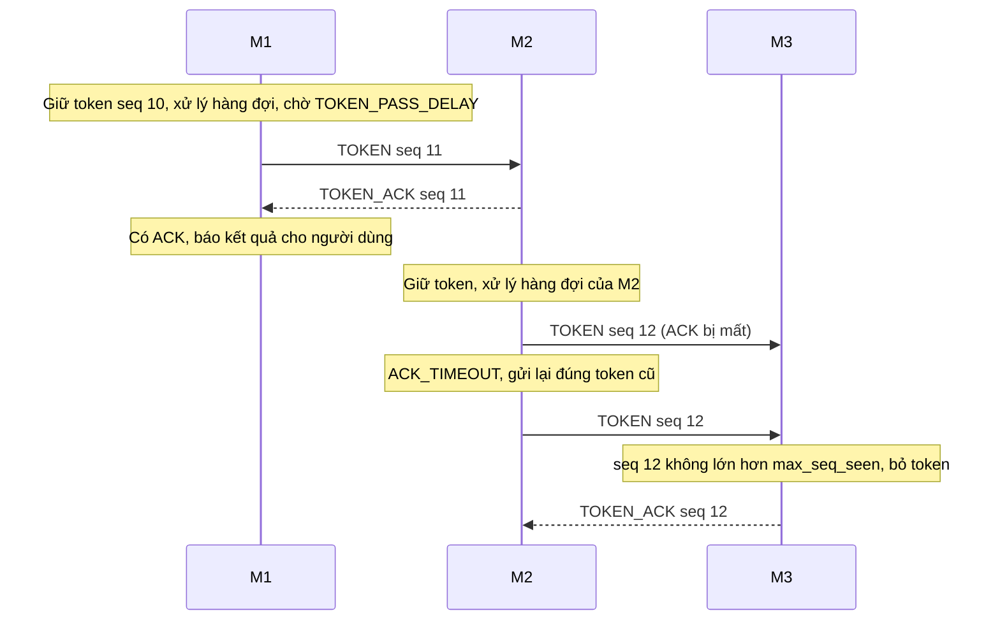
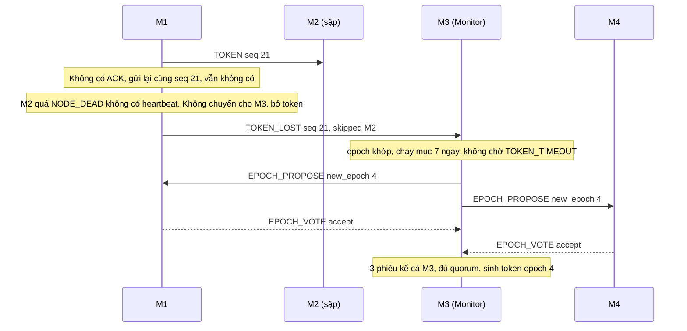
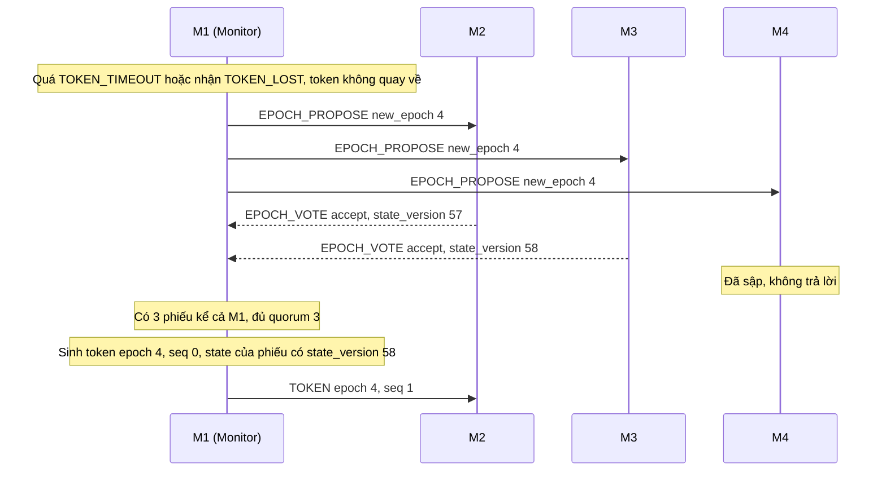
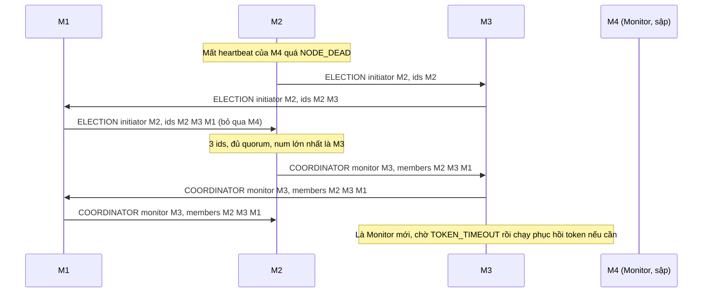
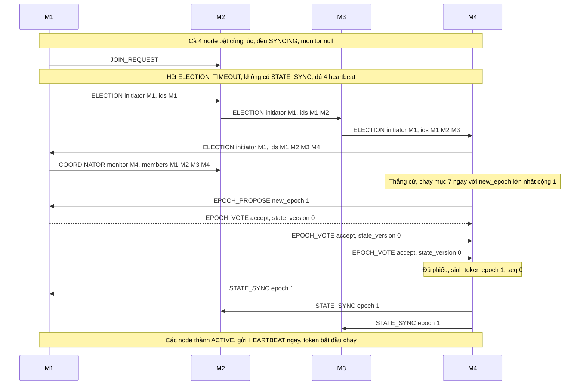
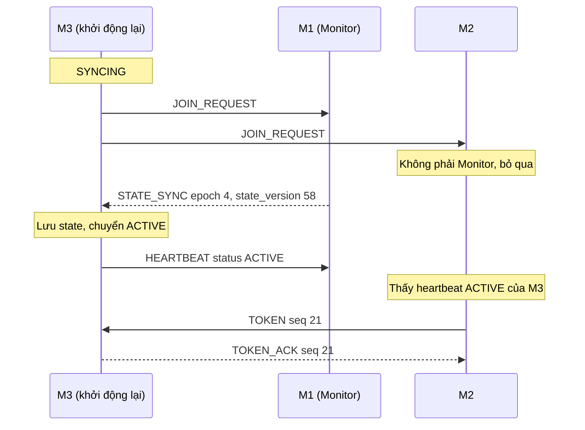

# Đặc tả giao thức Token Ring Lab

Tài liệu này là hợp đồng giữa 4 phần: **core** (lõi giao thức), **fault** (chịu lỗi), **storage** (lưu trữ, đo số liệu) và **ui** (giao diện). Tên trường và tên message trong đây là chuẩn; muốn đổi thì sửa tài liệu này trước, rồi mới sửa code.

## 0. Thuật ngữ

Ví dụ dùng chung: 4 máy `M1..M4` ngồi thành vòng và chuyền nhau một cây bút. Ai cầm bút mới được ghi vào sổ mượn thiết bị.

### Cơ bản

| Thuật ngữ | Nghĩa | Ví dụ |
|---|---|---|
| **Token (thẻ bài)** | Message duy nhất chạy quanh vòng; máy đang giữ token mới được sửa dữ liệu | Cây bút |
| **Critical section (CS)** | Đoạn việc mà tại mỗi lúc chỉ một máy được làm | Ghi "M2 mượn máy chiếu" vào sổ |
| **Loại trừ tương hỗ** | Bảo đảm không bao giờ có hai máy cùng ở trong CS | Hai người không thể cùng mượn một máy chiếu |
| **State** | Trạng thái kho thiết bị; dự án này để state đi kèm trong token | `DEV-01: BORROWED, borrowed_by: M2` |
| **`state_version`** | Số phiên bản của state, mỗi lần ghi thì tăng 1 | Version 57 mới hơn version 56; khi phải chọn thì lấy bản có version lớn nhất |

### Chống token cũ, token trùng

| Thuật ngữ | Nghĩa | Ví dụ |
|---|---|---|
| **`epoch`** | Thế hệ của token. Mỗi lần mất token và phải tạo lại thì epoch tăng 1; mọi token thuộc thế hệ cũ đều bị vô hiệu | Lớp làm mất bút số 3 nên phát bút số 4; ai còn cầm bút số 3 thì bị bỏ qua (TH5) |
| **`promised_epoch`** | Epoch cao nhất mà một máy đã đồng ý; token có epoch thấp hơn số này bị máy đó hủy | M2 đã đồng ý dùng bút số 4 nên gặp bút số 3 là bỏ |
| **`seq`** | Số thứ tự của từng lần chuyền token trong cùng một epoch | Lần chuyền thứ 128; nhận lại lần 128 lần nữa thì biết là bản trùng (TH14) |
| **`TOKEN_ACK`** | Máy nhận báo lại "tôi đã nhận token" | M3 nói "đã cầm bút". M2 chưa nghe câu đó thì chưa được coi là đã chuyền xong |
| **`TOKEN_LOST`** | Máy gửi báo Monitor rằng token có thể đã mất | M2 chuyền cho M3 mà chưa có ACK thì M3 chết, nên M2 báo Monitor để làm bút mới |

### Phát hiện máy sập

| Thuật ngữ | Nghĩa | Ví dụ |
|---|---|---|
| **Heartbeat** | Cứ mỗi giây, mỗi máy gửi tin "tôi còn sống" cho các máy khác | Điểm danh mỗi giây |
| **`NODE_DEAD` (3s)** | Quá 3 giây không có heartbeat thì máy đó bị coi là chết | Vì vậy ở TH11, đóng băng 4 giây là bị loại khỏi vòng |
| **`TOKEN_TIMEOUT` (6s)** | Quá 6 giây Monitor không thấy token quay về thì nghi token đã mất | TH4 (nút "Hủy Token") |
| **Timeout** | Thời gian chờ tối đa. Hết timeout chỉ là *nghi ngờ*, vì mạng có thể chỉ đang chậm | Vì thế tạo lại token phải qua biểu quyết |

### Điều phối

| Thuật ngữ | Nghĩa | Ví dụ |
|---|---|---|
| **Monitor** | Máy làm "giám thị": phát hiện mất token và tạo lại token. Ý tưởng lấy từ Active Monitor của IEEE 802.5 | Máy có biểu tượng vương miện trên giao diện |
| **Quorum (3/4)** | Số máy tối thiểu phải còn sống hoặc phải đồng ý thì mới được ghi; bằng quá nửa, `floor(N/2)+1` | Chỉ còn 2 máy (TH9) thì khóa Mượn/Trả, chỉ được xem |
| **`EPOCH_PROPOSE` / `EPOCH_VOTE`** | Monitor đề xuất lên epoch mới, các máy bỏ phiếu; có ít nhất quorum phiếu đồng ý thì mới sinh token mới | Không máy nào tự ý "in thêm bút" được |
| **Bầu cử vòng (`ELECTION` / `COORDINATOR`)** | Thuật toán ở slide 12. Khi Monitor chết, `ELECTION` chạy quanh vòng để gom ID của các máy còn sống; máy có ID lớn nhất làm Monitor mới; kết quả thông báo bằng `COORDINATOR` | M4 chết, gom được {1,2,3}, nên M3 làm Monitor |
| **Split-brain / phân mảnh mạng** | Mạng bị chia thành hai cụm, cụm nào cũng tưởng mình là cả hệ thống | Chia 2-2 thì không cụm nào đủ 3 máy, cả hai chỉ được xem (TH12) |

### Gia nhập lại

| Thuật ngữ | Nghĩa |
|---|---|
| **`SYNCING`** | Máy vừa bật, đang xin dữ liệu, chưa được nhận token |
| **`ACTIVE`** | Máy đã đồng bộ xong và đang chạy bình thường trong vòng |
| **`REJOINING`** | Máy phát hiện mình đã bị loại (ví dụ vì bị treo), nên bỏ token cũ và xin vào lại vòng |
| **`JOIN_REQUEST` / `STATE_SYNC`** | Máy gửi "cho tôi vào vòng", Monitor trả lại state và epoch mới nhất |
| **Khởi động lạnh** | Cả 4 máy cùng bật lần đầu, chưa có Monitor và chưa có token; các máy bầu cử trước rồi mới tạo token đầu tiên |

### Chống ghi trùng

| Thuật ngữ | Nghĩa | Ví dụ |
|---|---|---|
| **`request_id`** | Mã riêng của từng yêu cầu mượn hoặc trả | Gửi lại với cùng mã thì hệ thống biết là yêu cầu cũ, không ghi lần hai |
| **`recent_requests`** | 50 `request_id` vừa xử lý gần nhất, đi kèm trong token | Nhờ danh sách này, máy biết yêu cầu của mình đã thành công dù bị mất ACK |
| **`loan_id`** | Mã của một lượt mượn, bằng `request_id` của lần mượn đó | Dùng để biết lần trả nào ứng với lần mượn nào |
| **`state_hash`** | Dấu vân tay của state (sha256); 4 máy có cùng hash nghĩa là dữ liệu giống nhau | Dùng để kiểm 4 bản sao có khớp nhau không |

### Khác

- **Lamport timestamp:** đồng hồ logic, cứ gửi hoặc nhận message là tăng số đếm. Chỉ dùng để xếp log theo thứ tự trước sau, không dùng để quyết định.
- **Chaos hooks:** các nút giả lập lỗi trên giao diện (Hủy Token, Fake Lag, Đóng băng, Cô lập cụm...), dùng để diễn các trường hợp lúc demo.

## 1. Phạm vi và giả định

- Đây là **bản gọn, bám slide**: state nằm trong token. Biểu quyết 3/4 chỉ dùng khi **đổi epoch** (mục 7) và **bầu Monitor** (mục 8), không dùng cho từng thao tác mượn/trả.
- 4 node `M1..M4`, mỗi node là một tiến trình, nói chuyện với nhau qua TCP. Cả 4 node có thể chạy trên 1 máy (cổng khác nhau) hoặc trên 4 laptop.
- Các lỗi được xử lý: mất message, node sập, node treo tạm thời, phân mảnh mạng đối xứng. Node không gửi message sai nội dung (không có lỗi Byzantine).
- Đồng hồ hệ thống của các máy không được tin. Thứ tự sự kiện dựa vào `epoch`, `seq`, `state_version`; Lamport chỉ dùng để sắp xếp log.
- Tên thống nhất: `epoch`, `request_id`, `borrowed_by`, `seq`, node `M1..M4` (số `num` 1..4 chỉ dùng để so sánh khi bầu cử).
- Mỗi node giữ 3 biến giao thức; `promised_epoch` phải được lưu bền vững (mục 12):
  - `promised_epoch`: epoch cao nhất mà node đã chấp nhận. Token có epoch thấp hơn bị hủy.
  - `max_seq_seen`: `seq` lớn nhất đã nhận trong epoch hiện tại. Đặt về −1 mỗi khi `promised_epoch` tăng (Monitor vừa sinh token mới thì đặt về 0).
  - `monitor`: node đang được coi là Monitor.

## 2. Cấu hình

Mỗi node đọc cùng một file `config.json`; chỉ khác tham số dòng lệnh `node_id`.

```json
{
  "cluster_id": "lab-demo-01",
  "nodes": [
    {"id": "M1", "num": 1, "host": "127.0.0.1", "port": 5001},
    {"id": "M2", "num": 2, "host": "127.0.0.1", "port": 5002},
    {"id": "M3", "num": 3, "host": "127.0.0.1", "port": 5003},
    {"id": "M4", "num": 4, "host": "127.0.0.1", "port": 5004}
  ],
  "timeouts": {
    "HEARTBEAT_INTERVAL": 1.0,
    "NODE_DEAD": 3.0,
    "TOKEN_PASS_DELAY": 0.5,
    "ACK_TIMEOUT": 1.0,
    "ACK_RETRIES": 2,
    "TOKEN_TIMEOUT": 6.0,
    "VOTE_TIMEOUT": 2.0,
    "ELECTION_TIMEOUT": 3.0
  }
}
```

- Cổng mặc định 5001–5004, nên chạy được cả 4 node trên 1 máy (`127.0.0.1`). Khi chạy trên 4 laptop, đổi `host` thành địa chỉ trong mạng LAN của nhóm (ví dụ `192.168.1.x`); IP thật do nhóm tự điền khi chạy, không ghi vào tài liệu.
- **Thứ tự vòng cố định theo `num`**: M1 → M2 → M3 → M4 → M1.
- `quorum = floor(N/2) + 1`, với N là số node trong `nodes`. Bằng 3 khi có 4 node.
- Bảng timeout mặc định (đơn vị giây), có thể sửa trong `config.json`:

| Tên | Giá trị | Ý nghĩa |
|---|---|---|
| `HEARTBEAT_INTERVAL` | 1s | Chu kỳ gửi `HEARTBEAT` |
| `NODE_DEAD` | 3s | Quá thời gian này không có heartbeat thì coi node chết |
| `TOKEN_PASS_DELAY` | 0.5s | Giữ token một lúc trước khi chuyển, để mắt người theo kịp |
| `ACK_TIMEOUT` | 1s | Chờ `TOKEN_ACK`; không có thì gửi lại, tối đa 2 lần |
| `TOKEN_TIMEOUT` | 6s | Monitor không thấy token quay về |
| `VOTE_TIMEOUT` | 2s | Thời gian chờ phiếu `EPOCH_VOTE` |
| `ELECTION_TIMEOUT` | 3s | Thời gian chờ `ELECTION` quay về initiator |

Ràng buộc: thời gian `freeze` ở TH11 (4s) phải lớn hơn `NODE_DEAD` (3s). Nếu sửa một trong hai thì kiểm lại ràng buộc này.

## 3. Định dạng message

- TCP, mỗi dòng là **một message JSON UTF-8**, kết thúc bằng `\n`. Không có xuống dòng bên trong message.
- Node gửi tự mở kết nối tới peer khi cần. Kết nối đứt thì coi như message mất; các cơ chế ACK, heartbeat và timeout ở các mục sau lo phần còn lại.
- Header chung của **mọi** message:

| Trường | Ý nghĩa |
|---|---|
| `type` | Một trong 10 loại ở mục 4 |
| `from` | `id` node gửi, ví dụ `"M1"` |
| `to` | `id` node nhận |
| `epoch` | `promised_epoch` của node gửi lúc gửi (với `TOKEN` là epoch của token) |
| `lamport` | Đồng hồ Lamport của node gửi |
| `msg_id` | UUID của message, dùng cho log |

- **Lamport:** khi gửi thì `lamport += 1` rồi ghi vào message; khi nhận thì `lamport = max(local, recv) + 1`. Lamport chỉ dùng để sắp xếp log, **không dùng để quyết định**.
- **Nhận message có `epoch` cao hơn `promised_epoch` của mình** (trừ `EPOCH_PROPOSE`, `EPOCH_VOTE`, `JOIN_REQUEST` và `STATE_SYNC`): node chưa bỏ phiếu cho epoch đó nên đang lạc hậu; chuyển sang `REJOINING` (mục 9). Luật này **chỉ áp dụng cho node đang `ACTIVE`**. Node `SYNCING` hoặc `REJOINING` đã nằm trong luồng gia nhập (`JOIN_REQUEST`, `STATE_SYNC`) nên không bị chuyển trạng thái vì epoch cao hơn, và khởi động lạnh cũng chạy theo luật ở mục 9. Ngoại lệ `EPOCH_VOTE` là do phiếu từ chối mang header `epoch` bằng `promised_epoch` cao hơn của người từ chối; Monitor dùng giá trị đó để thử lại với `max + 1` (mục 7, bước 4) thay vì tự chuyển `REJOINING`.
- Node nhận message sai định dạng hoặc `type` lạ thì bỏ và phát sự kiện `MESSAGE_DROPPED` kèm lý do.

Ví dụ một message (đã xuống dòng cho dễ đọc; trên đường truyền là một dòng):

```json
{
  "type": "HEARTBEAT",
  "from": "M2",
  "to": "M3",
  "epoch": 3,
  "lamport": 345,
  "msg_id": "5b7c2f0e-6a8d-4c35-9d1e-3f2a7c9e1b40",
  "monitor": "M1",
  "state_version": 57,
  "status": "ACTIVE"
}
```

## 4. Bảng message

Mọi message có header ở mục 3. Bảng chỉ liệt kê trường **thêm vào**.

| Message | Trường thêm | Gửi khi nào, tới ai |
|---|---|---|
| `TOKEN` | `seq`, `holder`, `monitor`, `state_version`, `state`, `recent_requests` | Chuyển token tới node kế tiếp còn sống |
| `TOKEN_ACK` | `seq` | Bên nhận phản hồi bên gửi ngay khi nhận token hợp lệ |
| `TOKEN_LOST` | `seq`, `skipped` | Bên gửi token chưa được ACK báo Monitor khi node kế tiếp bị coi là chết (mục 5) |
| `HEARTBEAT` | `monitor`, `state_version`, `status` | Mỗi `HEARTBEAT_INTERVAL`, gửi tới mọi peer |
| `EPOCH_PROPOSE` | `new_epoch` | Monitor gửi tới mọi node khi nghi mất token |
| `EPOCH_VOTE` | `new_epoch`, `accept`, `state_version`, `state`, `recent_requests`; khi `accept = false` thêm `promised_epoch` | Node trả lời Monitor |
| `ELECTION` | `initiator`, `ids[]` | Chuyển quanh vòng khi mất Monitor |
| `COORDINATOR` | `monitor`, `members[]` | Initiator công bố kết quả bầu cử quanh vòng |
| `JOIN_REQUEST` | (không có) | Node mới khởi động hoặc `REJOINING` gửi tới mọi peer |
| `STATE_SYNC` | `epoch`, `monitor`, `members`, `state_version`, `state`, `recent_requests` | Monitor trả lời `JOIN_REQUEST` |

Quy ước kiểu dữ liệu:

- `state`: `{"DEV-01": {"status": "BORROWED", "borrowed_by": "M2", "loan_id": "req-0f3a91c2"}, "DEV-02": {"status": "AVAILABLE", "borrowed_by": null, "loan_id": null}}`. `status` là `AVAILABLE` hoặc `BORROWED`. `loan_id` bằng `request_id` của lần mượn đang diễn ra; là `null` khi `AVAILABLE`. Nhờ đó dữ liệu suy ra (`active_loan_id`, `state_hash`) giống nhau trên mọi node.
- `recent_requests`: danh sách tối đa **50** phần tử gần nhất, mỗi phần tử `{"request_id", "node_id", "device_id", "action", "result", "loan_id"}`. Dùng để bỏ `request_id` trùng và trả lại kết quả cũ. `loan_id` là mã lượt mượn của yêu cầu thành công: `BORROW` thì bằng `request_id`; `RETURN` thì bằng `loan_id` mà thiết bị đang có trong `state` ngay trước khi trả (mục 6); yêu cầu lỗi thì `null`.
- `holder`, `monitor`, `initiator`, `from`, `to`, phần tử của `ids` và `members`: đều là `id` dạng `"M1"`. So sánh lớn nhỏ khi bầu cử dùng `num` tra từ `config.json`, không so sánh chuỗi.
- `status` trong `HEARTBEAT`: `SYNCING`, `ACTIVE` hoặc `REJOINING` (mục 9). Node `SYNCING` gửi `monitor = null`.
- `EPOCH_VOTE` khi `accept = false`: **phải kèm `promised_epoch`** của node đó (epoch cao nhất nó đã hứa); các trường `state_version`, `state`, `recent_requests` có thể bỏ hoặc để `null`. Khi `accept = true` không cần `promised_epoch`.
- `TOKEN_LOST`: `from` là node đã gửi token, `epoch` trong header là epoch của token, `seq` là số `seq` của lần chuyển không được ACK, `skipped` là `id` node kế tiếp bị coi là chết.

**Định nghĩa "node còn sống"** (dùng khi chuyển token và đếm quorum để ghi, ở mục 5, 6, 7): có `HEARTBEAT` từ node đó trong vòng `NODE_DEAD` giây gần nhất **và** `status = ACTIVE`. Node luôn tính mình là sống. `members_alive` là tập các node sống.

**Ngoại lệ:** khi khởi động lạnh (mục 9), việc đếm node để bầu cử (mục 8) và bỏ phiếu đổi epoch (mục 7) tính **mọi trạng thái** (`SYNCING`, `ACTIVE`, `REJOINING`), miễn có heartbeat trong `NODE_DEAD` giây.

## 5. Luồng chuyển token

Bên nhận kiểm tra trước khi chấp nhận token:

1. Hủy nếu `token.epoch < promised_epoch` (TH5: token cũ trễ mạng).
2. Hủy nếu cùng epoch mà `seq <= max_seq_seen` (TH14: token trùng).
3. Hợp lệ: `max_seq_seen = seq`, lưu bản sao state cục bộ (mục 12), **rồi** gửi ngay `TOKEN_ACK{seq}`.

Bên gửi:

1. Giữ token `TOKEN_PASS_DELAY` giây, xử lý hàng đợi mượn/trả (mục 6).
2. Đặt `seq + 1`, chuyển cho node **kế tiếp còn sống** theo thứ tự vòng. Node đã bị coi là chết **trước khi gửi lần nào** thì bị bỏ qua ngay, không cần chờ; chưa có token nào gửi cho nó nên không có bản trùng.
3. Không có ACK sau `ACK_TIMEOUT` thì gửi lại **đúng token cũ, cùng `seq`**, tối đa `ACK_RETRIES` lần.
4. Hết số lần gửi lại mà node kia vẫn còn heartbeat thì bên gửi **tiếp tục chờ**, không chuyển cho ai khác. `TOKEN_TIMEOUT` ở Monitor (mục 7) là lưới an toàn cuối cho trường hợp ACK cứ mất mãi.
5. Gửi xong thì bên gửi **không còn quyền ghi**, kể cả khi chưa nhận ACK. Bản token cũ chỉ còn để gửi lại. Khi đã nhận ACK thì bên gửi **xóa** bản token này; từ đó chỉ node nhận giữ token.
6. **Quy tắc `TOKEN_LOST`:** nếu bên gửi có token **chưa được ACK** mà node kế tiếp bị coi là chết (quá `NODE_DEAD` không có heartbeat) thì bên gửi **không được tự chuyển token cho node sau đó**, vì node kia có thể vẫn sống và đã nhận token (ACK bị mất), khi đó sẽ có hai token cùng epoch. Bên gửi bỏ token rồi gửi `TOKEN_LOST{seq, skipped}` cho Monitor:
   - Monitor nhận `TOKEN_LOST` có `epoch` bằng `promised_epoch` thì chạy **ngay** mục 7 (đổi epoch, cần ≥ 3/4 phiếu), không chờ `TOKEN_TIMEOUT`. `TOKEN_LOST` có epoch nhỏ hơn thì bỏ (token đó đã bị đổi epoch rồi), và đang chạy dở một lượt mục 7 thì bỏ qua.
   - Bên gửi chính là Monitor thì chạy mục 7 luôn, không cần gửi `TOKEN_LOST`.
   - Node bị coi là chết (`skipped`) chính là Monitor thì làm mục 8 trước. Khi có `COORDINATOR`, bên gửi gửi `TOKEN_LOST` cho Monitor mới (nếu chính mình là Monitor mới thì chạy mục 7 luôn).
7. **Vì sao an toàn:** token trùng (nếu node kia thật ra vẫn sống) mang epoch cũ; các node đã hứa epoch mới sẽ hủy nó (phần kiểm tra của bên nhận, bước 1). Nếu node kia bị cô lập thì token chỉ quay trong cụm thiểu số, không đủ quorum nên không ghi được.
8. Token đã được ACK rồi mà node nhận chết sau đó (TH7) thì không có bản trùng nào: token mất cùng node đó, và Monitor phát hiện bằng `TOKEN_TIMEOUT` (mục 7).

Bên nhận gặp token trùng (cùng `seq` đã chấp nhận, do bên gửi gửi lại vì mất ACK) thì **bỏ token nhưng vẫn gửi lại `TOKEN_ACK`**, nếu không bên gửi sẽ không bao giờ nhận được ACK.



Trường hợp node kế tiếp chết khi token chưa được ACK (quy tắc `TOKEN_LOST`, bước 6):



Ví dụ message `TOKEN` (M1 chuyển cho M2), `TOKEN_ACK` tương ứng và `TOKEN_LOST`:

```json
{
  "type": "TOKEN",
  "from": "M1",
  "to": "M2",
  "epoch": 3,
  "lamport": 342,
  "msg_id": "0c9d6a3e-84b1-4f57-a2c0-7d1e5b8f3a96",
  "seq": 128,
  "holder": "M2",
  "monitor": "M1",
  "state_version": 57,
  "state": {
    "DEV-01": {"status": "BORROWED", "borrowed_by": "M2", "loan_id": "req-0f3a91c2"},
    "DEV-02": {"status": "AVAILABLE", "borrowed_by": null, "loan_id": null},
    "DEV-03": {"status": "AVAILABLE", "borrowed_by": null, "loan_id": null}
  },
  "recent_requests": [
    {"request_id": "req-0f3a91c2", "node_id": "M2", "device_id": "DEV-01", "action": "BORROW", "result": "SUCCESS", "loan_id": "req-0f3a91c2"},
    {"request_id": "req-7be410d8", "node_id": "M3", "device_id": "DEV-01", "action": "BORROW", "result": "ALREADY_BORROWED", "loan_id": null}
  ]
}
```

```json
{
  "type": "TOKEN_ACK",
  "from": "M2",
  "to": "M1",
  "epoch": 3,
  "lamport": 343,
  "msg_id": "e1a47c05-2b93-4d6f-8c18-0a5f9d3b7e22",
  "seq": 128
}
```

```json
{
  "type": "TOKEN_LOST",
  "from": "M1",
  "to": "M3",
  "epoch": 3,
  "lamport": 398,
  "msg_id": "2f6b9d04-8e17-4a53-b0c2-4d7a1e9f5c83",
  "seq": 21,
  "skipped": "M2"
}
```

## 6. Quy tắc ghi

Khớp quy tắc ghi bản gọn trong README.

Node chỉ ghi khi **đủ cả ba điều kiện**:

1. đang giữ token,
2. `token.epoch == promised_epoch`,
3. đếm được ít nhất `quorum` node sống (tính cả mình).

Xử lý hàng đợi local (tuần tự từng yêu cầu khi giữ token):

- `request_id` đã có trong `recent_requests` thì trả lại kết quả cũ đã ghi, **không ghi lại**.
- Chưa có: kiểm tra yêu cầu (mã kết quả ở dưới). Nếu thành công thì ghi `state` (mượn: `borrowed_by` là node mượn, `loan_id` là `request_id` của yêu cầu; trả: node giữ token **đọc `loan_id` hiện tại của thiết bị trong `state` trước**, dùng làm `loan_id` của dòng kết quả, rồi mới đặt `AVAILABLE`, `borrowed_by` và `loan_id` về `null`), tăng `state_version` thêm 1, lưu bản sao cục bộ; sau cùng chuyển token (mục 5). Kết quả (kể cả lỗi như `ALREADY_BORROWED`) được thêm vào `recent_requests`; khi vượt 50 phần tử thì bỏ phần tử cũ nhất.
- Node tự giữ yêu cầu đang chờ trong hàng đợi cục bộ cho tới khi **kết quả được xác định**, tức xảy ra **một trong hai**:
  - (a) nhận được `TOKEN_ACK` của token mang state mới. Khi đó state đã nằm trên ít nhất 2 máy (máy gửi và máy nhận).
  - (b) lần sau node giữ token, thấy `request_id` đó đã có trong `recent_requests`. Khi đó trả kết quả đã ghi, không ghi lại.
- Mất ACK nhưng token vẫn đi tiếp được xử lý bằng (b). Kết quả **chỉ báo cho người dùng khi đã xác định** theo (a) hoặc (b).
- Khi node bên gửi phải bỏ token vì `TOKEN_LOST` (mục 5, bước 6), state mới nó vừa ghi vẫn nằm trong bản sao cục bộ và được gửi trong `EPOCH_VOTE` của chính nó. Nếu state đó được giữ lại thì `recent_requests` của token mới chứa `request_id`, và (b) trả kết quả cho người dùng.

Các mã kết quả:

| Mã | Khi nào |
|---|---|
| `SUCCESS` | Mượn thiết bị đang `AVAILABLE`, hoặc trả thiết bị do chính node đó đang mượn |
| `ALREADY_BORROWED` | `BORROW` khi thiết bị đang `BORROWED` |
| `NOT_BORROWER` | `RETURN` khi thiết bị không do node này mượn (kể cả đang `AVAILABLE`) |
| `NOT_FOUND` | `device_id` không có trong `state` |
| `NO_QUORUM` | Không đủ `quorum` node sống |

- `NO_QUORUM` **trả ngay khi bấm** (không vào hàng đợi) và UI khóa nút Mượn/Trả. Khi `can_write` trở lại `true` thì UI mở khóa.
- Nếu node đã có yêu cầu trong hàng đợi mà mất quorum trước khi token tới, yêu cầu đó cũng trả `NO_QUORUM` khi token tới và không được ghi.
- Chỗ phải bảo đảm khi code: lưu bản sao cục bộ **trước** khi chuyển token hoặc gửi ACK. Nhờ vậy sau khi một thao tác đã báo `SUCCESS`, state mới có trên ít nhất 2 node; khi đổi epoch, `quorum` phiếu (3 trong 4 node) luôn có ít nhất một phiếu từ node giữ state đó, vì hai tập có kích thước 2 và 3 trong 4 node luôn giao nhau.

**Giới hạn đã thừa nhận:** nếu máy giữ token sập trước khi có ACK thì thao tác đó có thể mất. Người dùng chưa nhận kết quả nên khi node đó mở lại, UI truyền lại `request_id` cũ vào `submit`; `request_id` trùng sẽ bị bỏ qua nên không ghi hai lần (mục 12). Khi node không sập thì UI không cần làm gì thêm, node tự xác định kết quả theo (a) hoặc (b).

## 7. Phục hồi token

Dùng cho TH4 (mất token) và TH7 (node giữ token sập).

1. Monitor chạy mục này khi có **một trong ba** lý do:
   - quá `TOKEN_TIMEOUT` mà không nhận lại token (lưới an toàn cuối cho mọi trường hợp mất token);
   - nhận `TOKEN_LOST` hợp lệ (mục 5, bước 6), chạy ngay không chờ `TOKEN_TIMEOUT`;
   - vừa thắng cử khi khởi động lạnh (mục 9).

   Monitor đặt `new_epoch = promised_epoch + 1` (khi khởi động lạnh: `max(promised_epoch của mình, epoch trong heartbeat mới nhất của các node khác) + 1`; xem mục 9), đặt `promised_epoch = new_epoch`, bỏ token đang giữ (nếu có), rồi gửi `EPOCH_PROPOSE{new_epoch}` tới mọi node.
2. Node **đồng ý** khi `new_epoch > promised_epoch`. Khi đồng ý, node đặt `promised_epoch = new_epoch` (lưu bền vững **trước khi** trả lời), **bỏ token đang giữ (nếu có)**, đặt `max_seq_seen = -1`, rồi trả `EPOCH_VOTE{accept: true, state_version, state, recent_requests}` bằng bản sao state cục bộ. Không đồng ý (`new_epoch <= promised_epoch`) thì trả `EPOCH_VOTE{accept: false, promised_epoch}` kèm `promised_epoch` hiện tại của mình.
3. Trong `VOTE_TIMEOUT`, nếu có ít nhất `quorum` phiếu đồng ý (tính cả Monitor) thì Monitor sinh token mới:
   - `epoch = new_epoch`, `seq = 0`, `holder` và `monitor` đều là Monitor
   - `state`, `state_version` lấy từ phiếu có `state_version` lớn nhất
   - `recent_requests` gộp từ các phiếu (bỏ trùng `request_id`, giữ tối đa 50 phần tử gần nhất)
4. Không đủ phiếu thì **không sinh token**. Nếu trong các phiếu có `accept: false`, Monitor thử lại **ngay** (không chờ chu kỳ sau) với `new_epoch = max(các promised_epoch nhận được, promised_epoch của mình) + 1`. Không có phiếu từ chối nào mà vẫn thiếu phiếu (node không trả lời) thì thử lại ở chu kỳ `TOKEN_TIMEOUT` sau.
5. Khi khởi động lạnh, sinh token xong thì Monitor gửi `STATE_SYNC` cho mọi node đã bỏ phiếu đồng ý (mục 9).

Token cũ nào còn sót lại (TH5) sẽ bị bên nhận hủy theo mục 5, bước 1, vì `epoch` của nó nhỏ hơn `promised_epoch`.



```json
{
  "type": "EPOCH_PROPOSE",
  "from": "M1",
  "to": "M2",
  "epoch": 4,
  "lamport": 401,
  "msg_id": "9a3e5d71-0c46-4b8a-bf12-6d7e8c0a4f35",
  "new_epoch": 4
}
```

```json
{
  "type": "EPOCH_VOTE",
  "from": "M3",
  "to": "M1",
  "epoch": 4,
  "lamport": 403,
  "msg_id": "f4b20c97-35d1-4e6a-a8c3-1e9d7b5a0c68",
  "new_epoch": 4,
  "accept": true,
  "state_version": 58,
  "state": {
    "DEV-01": {"status": "AVAILABLE", "borrowed_by": null, "loan_id": null},
    "DEV-02": {"status": "BORROWED", "borrowed_by": "M3", "loan_id": "req-c81d5e07"},
    "DEV-03": {"status": "AVAILABLE", "borrowed_by": null, "loan_id": null}
  },
  "recent_requests": [
    {"request_id": "req-c81d5e07", "node_id": "M3", "device_id": "DEV-02", "action": "BORROW", "result": "SUCCESS", "loan_id": "req-c81d5e07"}
  ]
}
```

Phiếu từ chối (`accept = false`) phải kèm `promised_epoch` của node đó. Ở ví dụ dưới, M2 đã hứa epoch 6 nên từ chối `new_epoch = 4`; Monitor thử lại ngay với `new_epoch = 7` (lớn hơn mọi `promised_epoch` đã nhận):

```json
{
  "type": "EPOCH_VOTE",
  "from": "M2",
  "to": "M1",
  "epoch": 6,
  "lamport": 404,
  "msg_id": "a8d3f6c1-5e92-4b07-9c4a-0f1b7e2d6a35",
  "new_epoch": 4,
  "accept": false,
  "promised_epoch": 6
}
```

## 8. Bầu cử vòng

Ring election (slide 12), dùng cho TH8 (Monitor sập).

1. Node mất heartbeat của Monitor quá `NODE_DEAD` thì trở thành **initiator**. (Khi khởi động lạnh, điều kiện bắt đầu khác: xem mục 9; các bước sau giống nhau.) Initiator gửi `ELECTION{initiator: mình, ids: [mình]}` cho node kế tiếp còn sống.
2. Mỗi node nhận `ELECTION` gắn thêm `id` của mình vào `ids` rồi chuyển tiếp cho node kế tiếp còn sống (bỏ qua node sập).
3. Khi message về lại initiator (`initiator` là mình): nếu `ids` có ít nhất `quorum` phần tử thì initiator gửi `COORDINATOR{monitor: <id có num lớn nhất trong ids>, members: ids}` đi quanh vòng. Thiếu quorum thì **không có Monitor**, cả cụm chỉ xem; initiator thử lại sau `ELECTION_TIMEOUT` nếu vẫn chưa có Monitor.
4. Initiator không nhận lại `ELECTION` trong `ELECTION_TIMEOUT` thì coi như lượt đó thất bại và gửi lại với danh sách sống mới.
5. Node nhận `COORDINATOR` đặt `monitor` theo message và hủy các lượt bầu đang chờ; node giữ token ghi `monitor` mới vào token.
6. Nhiều initiator cùng lúc vẫn ra cùng một kết quả là `max(ids)` nên chấp nhận được; không cần chống trùng.
7. Monitor mới thấy chưa có token trong `TOKEN_TIMEOUT` thì chạy mục 7 (đổi epoch rồi sinh token). Nếu token cũ vẫn đang chạy (Monitor cũ sập khi không giữ token) thì Monitor mới thấy token đi qua và không cần đổi epoch. Trường hợp riêng: Monitor cũ là node `skipped` trong `TOKEN_LOST` thì sau bầu cử chạy mục 7 ngay (mục 5, bước 6); khi khởi động lạnh thì node thắng cử chạy mục 7 ngay (mục 9).

Ví dụ: M4 (Monitor) tắt. M2 phát hiện trước, gửi `ELECTION` với `ids = ["M2"]`; M3 thêm mình, M1 thêm mình (M4 bị bỏ qua), về M2 với `ids = ["M2","M3","M1"]` (3 phần tử, đủ quorum). `num` lớn nhất là 3, nên M3 làm Monitor.



```json
{
  "type": "ELECTION",
  "from": "M3",
  "to": "M1",
  "epoch": 3,
  "lamport": 512,
  "msg_id": "3d8f1b64-7a20-4c9e-b5d3-2f6a0e8c1b97",
  "initiator": "M2",
  "ids": ["M2", "M3"]
}
```

```json
{
  "type": "COORDINATOR",
  "from": "M2",
  "to": "M3",
  "epoch": 3,
  "lamport": 515,
  "msg_id": "b6c0e9a2-1f47-4d83-9e5b-8a3d7c2f0e14",
  "monitor": "M3",
  "members": ["M2", "M3", "M1"]
}
```

## 9. Trạng thái node và gia nhập

Ba trạng thái:

| Trạng thái | Ý nghĩa |
|---|---|
| `SYNCING` | Lúc khởi động. Gửi `JOIN_REQUEST` tới mọi peer, chờ `STATE_SYNC`; hết `ELECTION_TIMEOUT` mà chưa có thì xem "Khởi động lạnh" bên dưới |
| `ACTIVE` | Sau khi nhận `STATE_SYNC` từ Monitor: lưu state và bắt đầu nhận token |
| `REJOINING` | Khi phát hiện mình đã bị loại khỏi vòng |

- `can_write` **không phải là một trạng thái**. Đây là cờ suy ra: `status == ACTIVE` và còn đủ quorum node sống.
- Không có `STATE_SYNC` (vì không còn quorum, nên không có Monitor) thì node đứng ở `SYNCING` và chỉ xem. Node gửi lại `JOIN_REQUEST` mỗi `ELECTION_TIMEOUT` giây.
- Chỉ **Monitor** trả lời `JOIN_REQUEST` bằng `STATE_SYNC`. Nội dung lấy từ bản sao state mới nhất của Monitor, kèm `epoch`, `monitor`, `members` (các node sống) và `recent_requests`. Node nhận `STATE_SYNC` đặt `promised_epoch = epoch` (nếu lớn hơn) và `max_seq_seen = -1`.
- Không cần bước "chèn vào vòng" riêng: thứ tự vòng đã cố định, nên khi node đứng trước thấy heartbeat `ACTIVE` của node vừa vào thì tự chuyển token cho nó (mục 5).
- Chuyển sang `REJOINING` (TH11, TH13) khi một trong hai điều kiện đúng:
  - sau khi tỉnh lại (hết treo), thấy mình không nhận heartbeat nào trong khoảng thời gian dài hơn `NODE_DEAD`, hoặc
  - nhận message có `epoch` cao hơn `promised_epoch` của mình, khi đang `ACTIVE` (mục 3, trừ các loại message được miễn ở đó).
- Ở `REJOINING`: bỏ token đang giữ, rồi đi lại luồng `JOIN_REQUEST` như `SYNCING`. Yêu cầu đang chờ chia hai loại:
  - **Chưa ghi** (token chưa tới): trả `NO_QUORUM`, không ghi.
  - **Đã ghi nhưng chưa có `TOKEN_ACK`**: kết quả chưa biết, **không** trả `NO_QUORUM`. Sau khi nhận `STATE_SYNC`, tra `request_id` trong `recent_requests`: có thì trả kết quả đã ghi (quy tắc (b) mục 6); không có thì coi như chưa ghi và đưa lại vào hàng đợi với cùng `request_id`.

**Khởi động lạnh.** Dùng chung cho hai trường hợp: lần chạy đầu tiên, và cả cụm tắt hết rồi bật lại. Lúc đó không có Monitor nên không ai trả được `STATE_SYNC`:

1. Node ở `SYNCING` gửi `JOIN_REQUEST` tới mọi peer.
2. Hết `ELECTION_TIMEOUT` mà **đồng thời** (a) không nhận được `STATE_SYNC`, (b) không thấy heartbeat nào có `monitor` khác `null` (tức chưa ai báo đã có Monitor), và (c) đếm được ít nhất `quorum` node có heartbeat, tính cả mình, ở **mọi trạng thái**, thì node chạy bầu cử vòng (mục 8). Node đang `SYNCING` cũng được gắn `id` vào `ELECTION`.
3. Node thắng cử chạy mục 7 **ngay** với `new_epoch = max(promised_epoch đã lưu của mình, trường epoch trong heartbeat mới nhất của các node khác) + 1`. Header `epoch` của heartbeat chính là `promised_epoch` mà mỗi node đã nạp từ `Storage` lúc `start()`, nên Monitor có ước lượng ban đầu. Nếu vẫn bị từ chối vì thiếu node nào đó thì Monitor dựa vào `promised_epoch` trong phiếu `accept: false` để thử lại ngay (mục 7, bước 4).
4. Mỗi phiếu `EPOCH_VOTE` gửi kèm state lưu trong DB cục bộ của node đó. Nếu không node nào có state đã lưu thì dùng state khởi tạo: 3 thiết bị `AVAILABLE` (`borrowed_by` và `loan_id` là `null`), `state_version = 0`.
5. Sinh token xong, Monitor gửi `STATE_SYNC` cho mọi node đã bỏ phiếu đồng ý và tự chuyển sang `ACTIVE`. Các node đó nhận `STATE_SYNC` thì chuyển sang `ACTIVE` và gửi `HEARTBEAT` **ngay** (không chờ chu kỳ), để node đứng trước thấy `status = ACTIVE` kịp mà chuyển token.
6. Phân mảnh 2-2 hoặc chỉ bật được 1-2 máy thì điều kiện (c) không đạt: các node ở lại `SYNCING`, chỉ xem, và tiếp tục gửi `JOIN_REQUEST`.





```json
{
  "type": "JOIN_REQUEST",
  "from": "M3",
  "to": "M1",
  "epoch": 2,
  "lamport": 7,
  "msg_id": "c2d94e18-6b05-4a7f-8d31-9e0a5b7c3f62"
}
```

```json
{
  "type": "STATE_SYNC",
  "from": "M1",
  "to": "M3",
  "epoch": 4,
  "lamport": 640,
  "msg_id": "7e1a8b53-9c2d-4f06-a3e4-5b8d0c6f2a19",
  "monitor": "M1",
  "members": ["M1", "M2", "M3", "M4"],
  "state_version": 58,
  "state": {
    "DEV-01": {"status": "AVAILABLE", "borrowed_by": null, "loan_id": null},
    "DEV-02": {"status": "BORROWED", "borrowed_by": "M3", "loan_id": "req-c81d5e07"},
    "DEV-03": {"status": "AVAILABLE", "borrowed_by": null, "loan_id": null}
  },
  "recent_requests": [
    {"request_id": "req-c81d5e07", "node_id": "M3", "device_id": "DEV-02", "action": "BORROW", "result": "SUCCESS", "loan_id": "req-c81d5e07"}
  ]
}
```

## 10. Phân mảnh và giới hạn

- Phân mảnh (TH12) chỉ dựa vào **quorum** ở mục 6, 7 và 8. Không có cơ chế riêng nào khác.
  - Chia 3-1: nhóm 3 máy đủ quorum, ghi tiếp được (nếu cần thì đổi epoch và bầu Monitor trong nhóm); máy lẻ không đủ quorum nên chỉ xem.
  - Chia 2-2: cả hai bên không đủ quorum, không bên nào ghi, không bên nào bầu được Monitor hay sinh token mới.
- Hợp nhất mạng (TH13): bên thiểu số thấy epoch cao hơn nên chuyển `REJOINING`, bỏ token cũ, gửi `JOIN_REQUEST` và nhận `STATE_SYNC`.
- **Giới hạn đã thừa nhận:**
  - Máy giữ token sập trước khi có ACK thì thao tác đó có thể mất (mục 6); UI truyền lại `request_id` cũ khi node mở lại.
  - `recent_requests` chỉ giữ **50** `request_id` gần nhất. Một `request_id` cũ hơn 50 yêu cầu bị quên khỏi token, nên gửi lại quá muộn sẽ không còn bị chặn trùng. Chấp nhận được với demo.
  - Node bỏ lỡ một `EPOCH_PROPOSE` (mất message) sẽ thấy epoch cao hơn và chuyển `REJOINING` dù vẫn khỏe (mục 3). An toàn nhưng gây gián đoạn nhỏ.
  - Phân mảnh bất đối xứng (A thấy B nhưng B không thấy A) **không được bảo đảm**: mỗi node tự đếm quorum bằng heartbeat nên hai node có thể thấy hai tập node sống khác nhau.
  - Heartbeat là cách phát hiện lỗi không chính xác: node chậm hơn `NODE_DEAD` bị coi là chết dù còn sống.

## 11. Chaos hooks

Mô phỏng lỗi ở **tầng ứng dụng** (không cần chặn mạng thật). `RingNode` cung cấp hook, UI (Chaos Panel) nối nút vào.

| Hook | Tác dụng | TH |
|---|---|---|
| `drop_token()` | Hủy token. Nếu node đang giữ token thì bỏ ngay; nếu không thì bỏ token tiếp theo nhận được | TH4 |
| `resend_old_token()` | Node lưu bản sao token cuối cùng nó đã giữ; gọi hàm thì gửi lại bản sao đó cho node kế tiếp (epoch cũ nên bị hủy) | TH5 |
| `crash_on_next_token(bool)` | `True`: ngay khi nhận token, node dừng như bị sập (không ACK, không chuyển token, không gửi heartbeat). `False`: tắt chế độ | TH7 |
| `freeze(seconds)` | Đóng băng mọi hoạt động của node (gửi, nhận, heartbeat, timer) trong `seconds` giây; message tới trong lúc đóng băng bị bỏ | TH11 |
| `isolate(peer_ids)` | Bỏ mọi message **vào và ra** với các peer trong danh sách. Danh sách rỗng là bỏ cô lập | TH12, TH13 |
| `drop_next(type)` | Bỏ một message `TOKEN` hoặc `TOKEN_ACK` kế tiếp | TH14 |

- Mọi message bị bỏ do chaos hook đều phát sự kiện `MESSAGE_DROPPED` kèm lý do (ví dụ `isolated`, `frozen`, `drop_next`).
- Dừng node hẳn (TH6, TH8, TH9, TH10) là tắt tiến trình, không cần hook.

## 12. API RingNode và Storage

**Khởi tạo:** `RingNode(node_id, config, on_event)`

- `node_id`: `id` như `"M2"`; `config`: nội dung `config.json` đã đọc; `on_event(kind, data)`: callback nhận sự kiện (có thể được gọi từ luồng khác, UI tự chuyển về luồng giao diện).

**Hàm:**

| Hàm | Ý nghĩa |
|---|---|
| `start()` | Mở cổng TCP, nạp dữ liệu từ `Storage`, chạy ở trạng thái `SYNCING` |
| `stop()` | Dừng sạch node |
| `submit(device_id, action, request_id=None) -> Future[dict]` | `action` là `"BORROW"` hoặc `"RETURN"`. `request_id=None` thì node sinh `request_id` mới; UI chỉ truyền lại `request_id` cũ khi chính node đó đã sập rồi mở lại. Future hoàn thành khi kết quả được xác định theo (a) hoặc (b) ở mục 6 (hoặc ngay với `NO_QUORUM`) và trả về `{"request_id": "...", "result": "<mã ở mục 6>"}`, **luôn có `request_id`**. `request_id` đã có sẵn trong yêu cầu đang chờ thì trả lại cùng một kết quả, không tạo yêu cầu mới |
| `snapshot() -> dict` | Ảnh chụp trạng thái hiện tại để UI vẽ |
| Các chaos hook | Như mục 11 |

**`snapshot()` trả về:**

```json
{
  "node_id": "M2",
  "status": "ACTIVE",
  "monitor": "M1",
  "epoch": 3,
  "holder": "M3",
  "members_alive": ["M1", "M2", "M3", "M4"],
  "can_write": true,
  "ring": ["M1", "M2", "M3", "M4"],
  "state": {
    "DEV-01": {"status": "BORROWED", "borrowed_by": "M2", "loan_id": "req-0f3a91c2"},
    "DEV-02": {"status": "AVAILABLE", "borrowed_by": null, "loan_id": null},
    "DEV-03": {"status": "AVAILABLE", "borrowed_by": null, "loan_id": null}
  },
  "state_version": 57
}
```

`holder` là node giữ token theo hiểu biết gần nhất của node này (có thể chậm hơn thực tế một chặng).

**Sự kiện** qua `on_event(kind, data)`:

| `kind` | Khi nào |
|---|---|
| `MESSAGE_SENT` | Gửi một message (`data`: message) |
| `MESSAGE_RECEIVED` | Nhận một message |
| `MESSAGE_DROPPED` | Bỏ một message, `data` có kèm `reason` |
| `TOKEN` | Node nhận hoặc chuyển token |
| `STATE_CHANGED` | `state` hoặc `state_version` đổi |
| `ROLE_CHANGED` | Đổi `status` hoặc đổi Monitor |
| `QUORUM_CHANGED` | `can_write` đổi giá trị |
| `REQUEST_DONE` | Một yêu cầu `submit` có kết quả (`data`: `request_id`, `result`) |

Ví dụ `data` của một sự kiện `MESSAGE_DROPPED`:

```json
{
  "reason": "stale_epoch",
  "message": {"type": "TOKEN", "from": "M1", "to": "M2", "epoch": 2, "seq": 40}
}
```

**Interface `Storage`** (phần Duy; mỗi node một file SQLite `inventory.db` riêng):

| Hàm | Ý nghĩa |
|---|---|
| `load()` | Đọc lại `state`, `state_version`, `promised_epoch`, `monitor`, `last_seq` và các `request_results` gần nhất khi khởi động. Chưa có dữ liệu thì trả dữ liệu khởi tạo (3 thiết bị `AVAILABLE`, version 0) |
| `save_state(state, version, epoch, monitor, seq)` | Ghi `devices`, `state_metadata` (kể cả `state_hash` tự tính, xem dưới) và `protocol_state` trong **một transaction** SQLite cục bộ |
| `save_request(request_id, node_id, device_id, action, result, state_version, request_payload=None)` | Ghi một dòng `request_results`. `request_payload` chỉ có cho yêu cầu của chính node này |

Ánh xạ với `THIET_KE_DU_LIEU_KHO.md`:

| Dữ liệu giao thức | Bảng / cột |
|---|---|
| `state[DEV].status`, `state[DEV].borrowed_by` | `devices.status`, `devices.borrowed_by` |
| `state[DEV].loan_id` | `devices.active_loan_id` |
| `state_version` | `state_metadata.state_version` |
| sha256 của JSON `state` | `state_metadata.state_hash` |
| `epoch` (là `promised_epoch`), `monitor`, `seq` | `protocol_state.current_epoch`, `protocol_state.monitor_id`, `protocol_state.last_seq` (1 dòng) |
| `recent_requests` | `request_results` (`request_id`, `node_id`, `requested_device_id`, `action`, `result`, `state_version`) |

- `promised_epoch` **phải được lưu trước khi** gửi `EPOCH_VOTE` (mục 7), để node khởi động lại không chấp nhận lại token cũ.
- Lưu bản sao mỗi khi token đi qua (mục 5) là gọi `save_state`.
- **Dữ liệu suy ra phải giống nhau trên mọi node:**
  - `loan_id` nằm trong `state` của token, bằng `request_id` của lần mượn (mục 4), nên mọi node lưu cùng một `active_loan_id`.
  - `state_hash` = `"sha256:" + hexdigest` của chuỗi `json.dumps(state, sort_keys=True, separators=(",", ":"))` mã hóa UTF-8. Tính cục bộ trong `save_state`, không đi trong token.
  - `request_payload` chỉ lưu cục bộ cho yêu cầu do chính node này tạo, **không** đưa vào token. Với dòng `request_results` đến từ `recent_requests` của node khác thì `request_payload` là `NULL`.
  - `request_results.loan_id` lấy từ trường `loan_id` của phần tử `recent_requests`: `BORROW` thành công thì bằng `request_id`; `RETURN` thành công thì bằng `loan_id` của lượt mượn vừa được trả (người giữ token đọc từ `state` trước khi xóa). Yêu cầu lỗi thì `NULL`.

**Storage cần sửa (báo Duy cập nhật `THIET_KE_DU_LIEU_KHO.md`):**

1. Thêm bảng `protocol_state` (1 dòng): `current_epoch` (là `promised_epoch`), `monitor_id`, `last_seq`.
2. `devices.active_loan_id` lấy từ `state[DEV].loan_id`, không tự sinh cục bộ.
3. `state_metadata.state_hash` tính theo quy tắc ở trên (sắp xếp key, `separators=(",", ":")`).
4. `request_results.request_payload` đổi thành cho phép `NULL`, vì yêu cầu của node khác không có payload ở máy này.
5. Các ví dụ trong tài liệu dùng tên máy kiểu cũ; đổi sang `M1..M4`.

**Ghi chú:** dashboard hiện tại gọi `RingNode(node, MEMBERS, send)`, `start(state)` và `submit(operation)`. Cách gọi cũ này bị thay bằng API ở trên. `DemoRing` trong dashboard cần viết lại để tạo 4 `RingNode` thật trong cùng một tiến trình (cổng 5001–5004 trên `127.0.0.1`) cho chế độ mô phỏng 1 máy.

## 13. Đo số liệu

Phần của Duy (`metrics.py`). Ba số liệu, mỗi số có cách đếm cố định:

1. **Số chặng chờ** (so với lý thuyết N/2): từ lúc node `submit` tới lúc node đó được vào critical section.
   - `hops = seq của token lúc vào CS − max_seq_seen lúc submit`. Mỗi lần token chuyển đi là 1 chặng.
   - Mẫu nào có đổi epoch giữa chừng (`seq` bị đặt lại) thì bỏ khỏi thống kê.
   - Báo cáo trung bình và phân bố; đối chiếu với N/2 = 2 khi N = 4.
2. **Thời gian một vòng token:** Monitor ghi thời điểm mỗi lần nhận token; thời gian một vòng là hiệu hai lần nhận liên tiếp trong cùng epoch. Bỏ mẫu có đổi epoch ở giữa.
3. **Số message cho mỗi lần vào CS:** tổng số message `TOKEN` và `TOKEN_ACK` (kể cả gửi lại) mà các node gửi ra trong khoảng từ lúc `submit` tới lúc vào CS, cộng từ sự kiện `MESSAGE_SENT` ở Observer view. `HEARTBEAT` đếm riêng, không tính vào số này.

Mọi khoảng thời gian đo bằng đồng hồ đơn điệu của đúng node đo, không so sánh đồng hồ giữa các máy.

## 14. Bảng TH1–TH14 → mục xử lý

| TH | Nội dung | Mục xử lý |
|---|---|---|
| TH1 | Vòng rảnh, token luân chuyển | 5 |
| TH2 | Một máy mượn/trả | 5, 6 |
| TH3 | Tranh chấp đồng thời 1 máy chiếu (4 người bấm cùng lúc) | 5, 6. Chế độ "tắt Token Ring" **không thuộc** `RingNode`: đây là chế độ `unsafe` riêng của dashboard mô phỏng 1 máy, mỗi node đọc state, chờ 300ms, rồi ghi, không cần token |
| TH4 | Mất token | 7, 11 (`drop_token`) |
| TH5 | Token cũ trễ mạng | 5 (bước 1), 7, 11 (`resend_old_token`) |
| TH6 | Máy thường sập lúc rảnh | 5 (bước 2: bỏ qua node đã chết từ trước; bước 6: nếu sập giữa lúc gửi token thì `TOKEN_LOST`), 4 (định nghĩa node sống) |
| TH7 | Máy sập lúc đang giữ token | 5 (bước 6, `TOKEN_LOST` nếu chưa ACK; bước 8, `TOKEN_TIMEOUT` nếu đã ACK), 7, 6 (giới hạn), 11 (`crash_on_next_token`) |
| TH8 | Sập máy Monitor | 8, 7 |
| TH9 | Hai máy sập cùng lúc (còn 2/4, khóa Mượn/Trả) | 6 (quorum, `NO_QUORUM`), 5 (bước 6: `TOKEN_LOST` nếu một máy sập khi token chưa ACK, nhưng 2 phiếu không đủ quorum nên không sinh token mới), 9 |
| TH10 | Máy khởi động lại, vào lại vòng (cả cụm tắt hết rồi bật lại: khởi động lạnh) | 9 |
| TH11 | Máy treo tạm thời | 9 (`REJOINING`), 11 (`freeze`) |
| TH12 | Phân mảnh mạng 3-1 và 2-2 | 10, 6, 7, 8, 11 (`isolate`) |
| TH13 | (tùy chọn) Hợp nhất mạng | 9, 10, 11 (`isolate`) |
| TH14 | (tùy chọn) Mất token/ACK khi chuyển | 5 (bước 2 của bên nhận và token trùng; bước 3 và 4: gửi lại cùng `seq`, node còn heartbeat thì không phát `TOKEN_LOST`), 11 (`drop_next`) |
