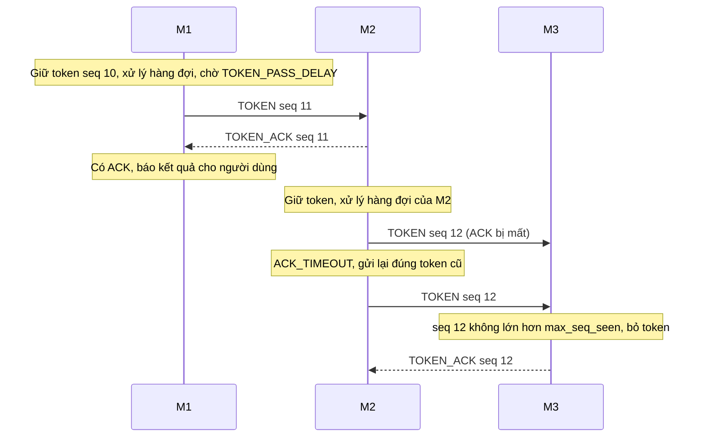
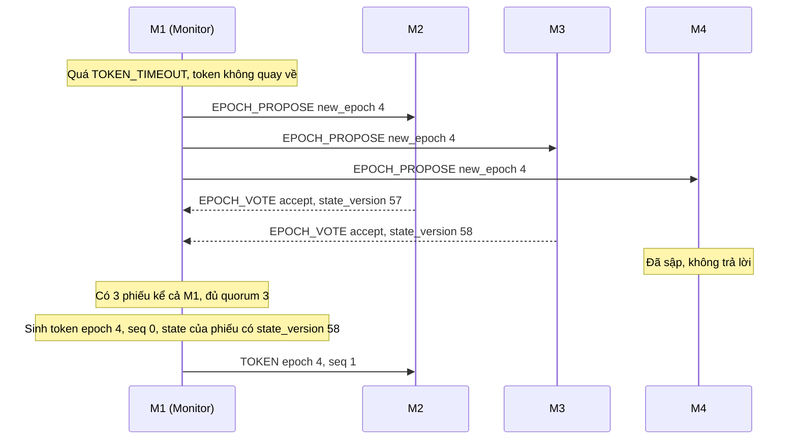
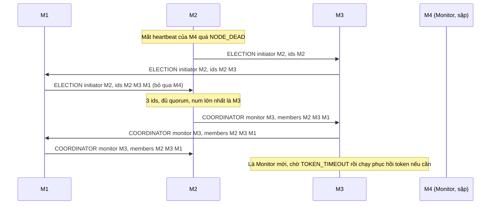
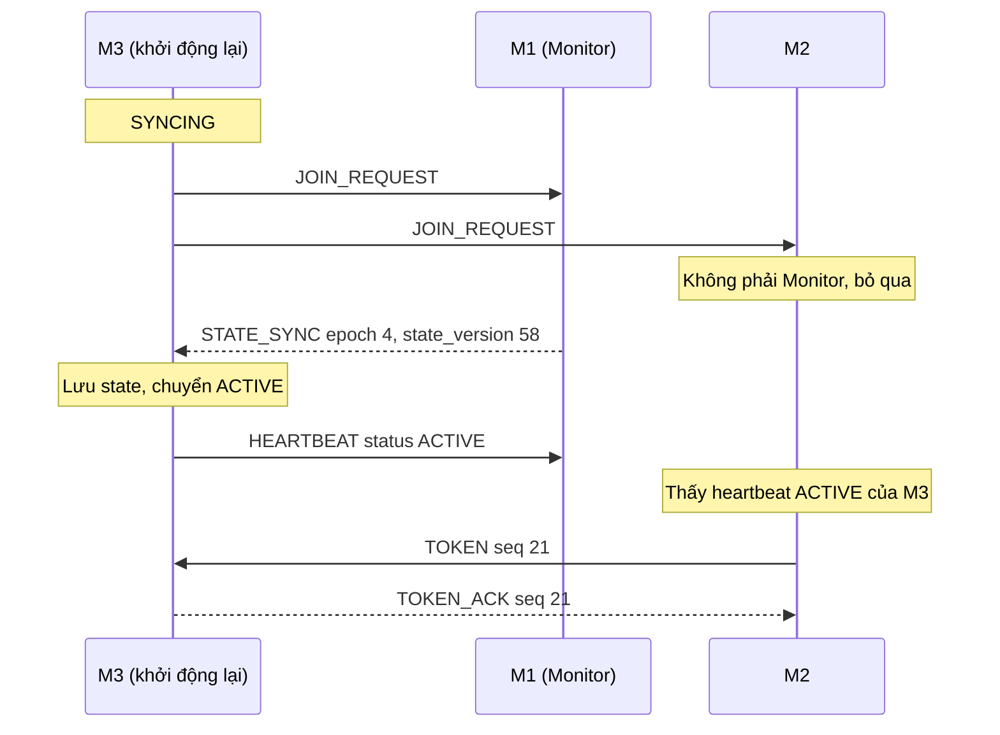

# Đặc tả giao thức Token Ring Lab

Tài liệu này là hợp đồng giữa 4 phần: **core** (lõi giao thức), **fault** (chịu lỗi), **storage** (lưu trữ, đo số liệu) và **ui** (giao diện). Tên trường và tên message trong đây là chuẩn; muốn đổi thì sửa tài liệu này trước, rồi mới sửa code.

## 1. Phạm vi và giả định

- Đây là **bản gọn, bám slide**: state nằm trong token. Biểu quyết 3/4 chỉ dùng khi **đổi epoch** (mục 7) và **bầu Monitor** (mục 8), không dùng cho từng thao tác mượn/trả.
- 4 node `M1..M4`, mỗi node là một tiến trình, nói chuyện với nhau qua TCP. Cả 4 node có thể chạy trên 1 máy (cổng khác nhau) hoặc trên 4 laptop.
- Các lỗi được xử lý: mất message, node sập, node treo tạm thời, phân mảnh mạng đối xứng. Node không gửi message sai nội dung (không có lỗi Byzantine).
- Đồng hồ hệ thống của các máy không được tin. Thứ tự sự kiện dựa vào `epoch`, `seq`, `state_version`; Lamport chỉ dùng để sắp xếp log.
- Tên thống nhất: `epoch`, `request_id`, `borrowed_by`, `seq`, node `M1..M4` (số `num` 1..4 chỉ dùng để so sánh khi bầu cử).
- Mỗi node giữ 3 biến giao thức; `promised_epoch` phải được lưu bền vững (mục 12):
  - `promised_epoch`: epoch cao nhất mà node đã chấp nhận. Token có epoch thấp hơn bị hủy.
  - `max_seq_seen`: `seq` lớn nhất đã nhận trong epoch hiện tại. Đặt về −1 mỗi khi `promised_epoch` tăng (Monitor vừa sinh token mới thì đặt về 0).
  - `monitor`: node đang được coi là Monitor.

## 2. Cấu hình

Mỗi node đọc cùng một file `config.json`; chỉ khác tham số dòng lệnh `node_id`.

```json
{
  "cluster_id": "lab-demo-01",
  "nodes": [
    {"id": "M1", "num": 1, "host": "127.0.0.1", "port": 5001},
    {"id": "M2", "num": 2, "host": "127.0.0.1", "port": 5002},
    {"id": "M3", "num": 3, "host": "127.0.0.1", "port": 5003},
    {"id": "M4", "num": 4, "host": "127.0.0.1", "port": 5004}
  ],
  "timeouts": {
    "HEARTBEAT_INTERVAL": 1.0,
    "NODE_DEAD": 3.0,
    "TOKEN_PASS_DELAY": 0.5,
    "ACK_TIMEOUT": 1.0,
    "ACK_RETRIES": 2,
    "TOKEN_TIMEOUT": 6.0,
    "VOTE_TIMEOUT": 2.0,
    "ELECTION_TIMEOUT": 3.0
  }
}
```

- Cổng mặc định 5001–5004, nên chạy được cả 4 node trên 1 máy (`127.0.0.1`). Khi chạy trên 4 laptop, đổi `host` thành địa chỉ trong mạng LAN của nhóm (ví dụ `192.168.1.x`); IP thật do nhóm tự điền khi chạy, không ghi vào tài liệu.
- **Thứ tự vòng cố định theo `num`**: M1 → M2 → M3 → M4 → M1.
- `quorum = floor(N/2) + 1`, với N là số node trong `nodes`. Bằng 3 khi có 4 node.
- Bảng timeout mặc định (đơn vị giây), có thể sửa trong `config.json`:

| Tên | Giá trị | Ý nghĩa |
|---|---|---|
| `HEARTBEAT_INTERVAL` | 1s | Chu kỳ gửi `HEARTBEAT` |
| `NODE_DEAD` | 3s | Quá thời gian này không có heartbeat thì coi node chết |
| `TOKEN_PASS_DELAY` | 0.5s | Giữ token một lúc trước khi chuyển, để mắt người theo kịp |
| `ACK_TIMEOUT` | 1s | Chờ `TOKEN_ACK`; không có thì gửi lại, tối đa 2 lần |
| `TOKEN_TIMEOUT` | 6s | Monitor không thấy token quay về |
| `VOTE_TIMEOUT` | 2s | Thời gian chờ phiếu `EPOCH_VOTE` |
| `ELECTION_TIMEOUT` | 3s | Thời gian chờ `ELECTION` quay về initiator |

Ràng buộc: thời gian `freeze` ở TH11 (4s) phải lớn hơn `NODE_DEAD` (3s). Nếu sửa một trong hai thì kiểm lại ràng buộc này.

## 3. Định dạng message

- TCP, mỗi dòng là **một message JSON UTF-8**, kết thúc bằng `\n`. Không có xuống dòng bên trong message.
- Node gửi tự mở kết nối tới peer khi cần. Kết nối đứt thì coi như message mất; các cơ chế ACK, heartbeat và timeout ở các mục sau lo phần còn lại.
- Header chung của **mọi** message:

| Trường | Ý nghĩa |
|---|---|
| `type` | Một trong 9 loại ở mục 4 |
| `from` | `id` node gửi, ví dụ `"M1"` |
| `to` | `id` node nhận |
| `epoch` | `promised_epoch` của node gửi lúc gửi (với `TOKEN` là epoch của token) |
| `lamport` | Đồng hồ Lamport của node gửi |
| `msg_id` | UUID của message, dùng cho log |

- **Lamport:** khi gửi thì `lamport += 1` rồi ghi vào message; khi nhận thì `lamport = max(local, recv) + 1`. Lamport chỉ dùng để sắp xếp log, **không dùng để quyết định**.
- **Nhận message có `epoch` cao hơn `promised_epoch` của mình** (trừ `EPOCH_PROPOSE`, `JOIN_REQUEST` và `STATE_SYNC`): node chưa bỏ phiếu cho epoch đó nên đang lạc hậu; chuyển sang `REJOINING` (mục 9).
- Node nhận message sai định dạng hoặc `type` lạ thì bỏ và phát sự kiện `MESSAGE_DROPPED` kèm lý do.

Ví dụ một message (đã xuống dòng cho dễ đọc; trên đường truyền là một dòng):

```json
{
  "type": "HEARTBEAT",
  "from": "M2",
  "to": "M3",
  "epoch": 3,
  "lamport": 345,
  "msg_id": "5b7c2f0e-6a8d-4c35-9d1e-3f2a7c9e1b40",
  "monitor": "M1",
  "state_version": 57,
  "status": "ACTIVE"
}
```

## 4. Bảng message

Mọi message có header ở mục 3. Bảng chỉ liệt kê trường **thêm vào**.

| Message | Trường thêm | Gửi khi nào, tới ai |
|---|---|---|
| `TOKEN` | `seq`, `holder`, `monitor`, `state_version`, `state`, `recent_requests` | Chuyển token tới node kế tiếp còn sống |
| `TOKEN_ACK` | `seq` | Bên nhận phản hồi bên gửi ngay khi nhận token hợp lệ |
| `HEARTBEAT` | `monitor`, `state_version`, `status` | Mỗi `HEARTBEAT_INTERVAL`, gửi tới mọi peer |
| `EPOCH_PROPOSE` | `new_epoch` | Monitor gửi tới mọi node khi nghi mất token |
| `EPOCH_VOTE` | `new_epoch`, `accept`, `state_version`, `state`, `recent_requests` | Node trả lời Monitor |
| `ELECTION` | `initiator`, `ids[]` | Chuyển quanh vòng khi mất Monitor |
| `COORDINATOR` | `monitor`, `members[]` | Initiator công bố kết quả bầu cử quanh vòng |
| `JOIN_REQUEST` | (không có) | Node mới khởi động hoặc `REJOINING` gửi tới mọi peer |
| `STATE_SYNC` | `epoch`, `monitor`, `members`, `state_version`, `state`, `recent_requests` | Monitor trả lời `JOIN_REQUEST` |

Quy ước kiểu dữ liệu:

- `state`: `{"DEV-01": {"status": "BORROWED", "borrowed_by": "M2"}, "DEV-02": {"status": "AVAILABLE", "borrowed_by": null}}`. `status` là `AVAILABLE` hoặc `BORROWED`.
- `recent_requests`: danh sách tối đa **50** phần tử gần nhất, mỗi phần tử `{"request_id", "node_id", "device_id", "action", "result"}`. Dùng để bỏ `request_id` trùng và trả lại kết quả cũ.
- `holder`, `monitor`, `initiator`, `from`, `to`, phần tử của `ids` và `members`: đều là `id` dạng `"M1"`. So sánh lớn nhỏ khi bầu cử dùng `num` tra từ `config.json`, không so sánh chuỗi.
- `status` trong `HEARTBEAT`: `SYNCING`, `ACTIVE` hoặc `REJOINING` (mục 9).
- `EPOCH_VOTE` khi `accept = false`: các trường `state_version`, `state`, `recent_requests` có thể bỏ hoặc để `null`.

**Định nghĩa "node còn sống"** (dùng ở mục 5, 6, 7, 8): có `HEARTBEAT` từ node đó trong vòng `NODE_DEAD` giây gần nhất và `status = ACTIVE`. Node luôn tính mình là sống. `members_alive` là tập các node sống.

## 5. Luồng chuyển token

Bên nhận kiểm tra trước khi chấp nhận token:

1. Hủy nếu `token.epoch < promised_epoch` (TH5: token cũ trễ mạng).
2. Hủy nếu cùng epoch mà `seq <= max_seq_seen` (TH14: token trùng).
3. Hợp lệ: `max_seq_seen = seq`, lưu bản sao state cục bộ (mục 12), **rồi** gửi ngay `TOKEN_ACK{seq}`.

Bên gửi:

1. Giữ token `TOKEN_PASS_DELAY` giây, xử lý hàng đợi mượn/trả (mục 6).
2. Đặt `seq + 1`, chuyển cho node **kế tiếp còn sống** theo thứ tự vòng.
3. Không có ACK sau `ACK_TIMEOUT` thì gửi lại **đúng token cũ, cùng `seq`**, tối đa `ACK_RETRIES` lần.
4. Chỉ chuyển sang node kế tiếp nữa khi node kia đã bị coi là chết theo heartbeat (quá `NODE_DEAD`). Đây là TH6 và TH9. Hết số lần gửi lại mà node kia vẫn còn heartbeat thì bên gửi **không** bỏ qua node đó; nó tiếp tục chờ cho tới khi node kia chết theo heartbeat hoặc Monitor đổi epoch.
5. Gửi xong thì bên gửi **không còn quyền ghi**, kể cả khi chưa nhận ACK. Bản token cũ chỉ còn để gửi lại.

Bên nhận gặp token trùng (cùng `seq` đã chấp nhận, do bên gửi gửi lại vì mất ACK) thì **bỏ token nhưng vẫn gửi lại `TOKEN_ACK`**, nếu không bên gửi sẽ không bao giờ nhận được ACK.



Ví dụ message `TOKEN` (M1 chuyển cho M2) và `TOKEN_ACK` tương ứng:

```json
{
  "type": "TOKEN",
  "from": "M1",
  "to": "M2",
  "epoch": 3,
  "lamport": 342,
  "msg_id": "0c9d6a3e-84b1-4f57-a2c0-7d1e5b8f3a96",
  "seq": 128,
  "holder": "M2",
  "monitor": "M1",
  "state_version": 57,
  "state": {
    "DEV-01": {"status": "BORROWED", "borrowed_by": "M2"},
    "DEV-02": {"status": "AVAILABLE", "borrowed_by": null},
    "DEV-03": {"status": "AVAILABLE", "borrowed_by": null}
  },
  "recent_requests": [
    {"request_id": "req-0f3a91c2", "node_id": "M2", "device_id": "DEV-01", "action": "BORROW", "result": "SUCCESS"},
    {"request_id": "req-7be410d8", "node_id": "M3", "device_id": "DEV-01", "action": "BORROW", "result": "ALREADY_BORROWED"}
  ]
}
```

```json
{
  "type": "TOKEN_ACK",
  "from": "M2",
  "to": "M1",
  "epoch": 3,
  "lamport": 343,
  "msg_id": "e1a47c05-2b93-4d6f-8c18-0a5f9d3b7e22",
  "seq": 128
}
```

## 6. Quy tắc ghi

Khớp quy tắc ghi bản gọn trong README.

Node chỉ ghi khi **đủ cả ba điều kiện**:

1. đang giữ token,
2. `token.epoch == promised_epoch`,
3. đếm được ít nhất `quorum` node sống (tính cả mình).

Xử lý hàng đợi local (tuần tự từng yêu cầu khi giữ token):

- `request_id` đã có trong `recent_requests` thì trả lại kết quả cũ, **không ghi lại**.
- Chưa có: kiểm tra yêu cầu (mã kết quả ở dưới). Nếu thành công thì ghi `state`, tăng `state_version` thêm 1, lưu bản sao cục bộ; sau cùng chuyển token (mục 5). Kết quả (kể cả lỗi như `ALREADY_BORROWED`) được thêm vào `recent_requests`; khi vượt 50 phần tử thì bỏ phần tử cũ nhất.
- Kết quả **chỉ báo cho người dùng khi có `TOKEN_ACK`** của token mang state mới. Khi đó state đã nằm trên ít nhất 2 máy (máy gửi và máy nhận).

Các mã kết quả:

| Mã | Khi nào |
|---|---|
| `SUCCESS` | Mượn thiết bị đang `AVAILABLE`, hoặc trả thiết bị do chính node đó đang mượn |
| `ALREADY_BORROWED` | `BORROW` khi thiết bị đang `BORROWED` |
| `NOT_BORROWER` | `RETURN` khi thiết bị không do node này mượn (kể cả đang `AVAILABLE`) |
| `NOT_FOUND` | `device_id` không có trong `state` |
| `NO_QUORUM` | Không đủ `quorum` node sống |

- `NO_QUORUM` **trả ngay khi bấm** (không vào hàng đợi) và UI khóa nút Mượn/Trả. Khi `can_write` trở lại `true` thì UI mở khóa.
- Nếu node đã có yêu cầu trong hàng đợi mà mất quorum trước khi token tới, yêu cầu đó cũng trả `NO_QUORUM` khi token tới và không được ghi.
- Chỗ phải bảo đảm khi code: lưu bản sao cục bộ **trước** khi chuyển token hoặc gửi ACK. Nhờ vậy sau khi một thao tác đã báo `SUCCESS`, state mới có trên ít nhất 2 node; khi đổi epoch, `quorum` phiếu (3 trong 4 node) luôn có ít nhất một phiếu từ node giữ state đó, vì hai tập có kích thước 2 và 3 trong 4 node luôn giao nhau.

**Giới hạn đã thừa nhận:** nếu máy giữ token sập trước khi có ACK thì thao tác đó mất. Người dùng chưa nhận `SUCCESS` nên gửi lại với cùng `request_id`; `request_id` trùng sẽ bị bỏ qua nên không ghi hai lần.

## 7. Phục hồi token

Dùng cho TH4 (mất token) và TH7 (node giữ token sập).

1. Monitor quá `TOKEN_TIMEOUT` mà không nhận lại token thì đặt `new_epoch = promised_epoch + 1`, đặt `promised_epoch = new_epoch`, bỏ token đang giữ (nếu có), rồi gửi `EPOCH_PROPOSE{new_epoch}` tới mọi node.
2. Node **đồng ý** khi `new_epoch > promised_epoch`. Khi đồng ý, node đặt `promised_epoch = new_epoch` (lưu bền vững **trước khi** trả lời), **bỏ token đang giữ (nếu có)**, đặt `max_seq_seen = -1`, rồi trả `EPOCH_VOTE{accept: true, state_version, state, recent_requests}` bằng bản sao state cục bộ. Không đồng ý thì trả `accept: false`.
3. Trong `VOTE_TIMEOUT`, nếu có ít nhất `quorum` phiếu đồng ý (tính cả Monitor) thì Monitor sinh token mới:
   - `epoch = new_epoch`, `seq = 0`, `holder` và `monitor` đều là Monitor
   - `state`, `state_version` lấy từ phiếu có `state_version` lớn nhất
   - `recent_requests` gộp từ các phiếu (bỏ trùng `request_id`, giữ tối đa 50 phần tử gần nhất)
4. Không đủ phiếu thì **không sinh token**, thử lại ở chu kỳ `TOKEN_TIMEOUT` sau.

Token cũ nào còn sót lại (TH5) sẽ bị bên nhận hủy theo mục 5, bước 1, vì `epoch` của nó nhỏ hơn `promised_epoch`.



```json
{
  "type": "EPOCH_PROPOSE",
  "from": "M1",
  "to": "M2",
  "epoch": 4,
  "lamport": 401,
  "msg_id": "9a3e5d71-0c46-4b8a-bf12-6d7e8c0a4f35",
  "new_epoch": 4
}
```

```json
{
  "type": "EPOCH_VOTE",
  "from": "M3",
  "to": "M1",
  "epoch": 4,
  "lamport": 403,
  "msg_id": "f4b20c97-35d1-4e6a-a8c3-1e9d7b5a0c68",
  "new_epoch": 4,
  "accept": true,
  "state_version": 58,
  "state": {
    "DEV-01": {"status": "AVAILABLE", "borrowed_by": null},
    "DEV-02": {"status": "BORROWED", "borrowed_by": "M3"},
    "DEV-03": {"status": "AVAILABLE", "borrowed_by": null}
  },
  "recent_requests": [
    {"request_id": "req-c81d5e07", "node_id": "M3", "device_id": "DEV-02", "action": "BORROW", "result": "SUCCESS"}
  ]
}
```

## 8. Bầu cử vòng

Ring election (slide 12), dùng cho TH8 (Monitor sập).

1. Node mất heartbeat của Monitor quá `NODE_DEAD` thì trở thành **initiator**: gửi `ELECTION{initiator: mình, ids: [mình]}` cho node kế tiếp còn sống.
2. Mỗi node nhận `ELECTION` gắn thêm `id` của mình vào `ids` rồi chuyển tiếp cho node kế tiếp còn sống (bỏ qua node sập).
3. Khi message về lại initiator (`initiator` là mình): nếu `ids` có ít nhất `quorum` phần tử thì initiator gửi `COORDINATOR{monitor: <id có num lớn nhất trong ids>, members: ids}` đi quanh vòng. Thiếu quorum thì **không có Monitor**, cả cụm chỉ xem; initiator thử lại sau `ELECTION_TIMEOUT` nếu vẫn chưa có Monitor.
4. Initiator không nhận lại `ELECTION` trong `ELECTION_TIMEOUT` thì coi như lượt đó thất bại và gửi lại với danh sách sống mới.
5. Node nhận `COORDINATOR` đặt `monitor` theo message và hủy các lượt bầu đang chờ; node giữ token ghi `monitor` mới vào token.
6. Nhiều initiator cùng lúc vẫn ra cùng một kết quả là `max(ids)` nên chấp nhận được; không cần chống trùng.
7. Monitor mới thấy chưa có token trong `TOKEN_TIMEOUT` thì chạy mục 7 (đổi epoch rồi sinh token). Nếu token cũ vẫn đang chạy (Monitor cũ sập khi không giữ token) thì Monitor mới thấy token đi qua và không cần đổi epoch.

Ví dụ: M4 (Monitor) tắt. M2 phát hiện trước, gửi `ELECTION` với `ids = ["M2"]`; M3 thêm mình, M1 thêm mình (M4 bị bỏ qua), về M2 với `ids = ["M2","M3","M1"]` (3 phần tử, đủ quorum). `num` lớn nhất là 3, nên M3 làm Monitor.



```json
{
  "type": "ELECTION",
  "from": "M3",
  "to": "M1",
  "epoch": 3,
  "lamport": 512,
  "msg_id": "3d8f1b64-7a20-4c9e-b5d3-2f6a0e8c1b97",
  "initiator": "M2",
  "ids": ["M2", "M3"]
}
```

```json
{
  "type": "COORDINATOR",
  "from": "M2",
  "to": "M3",
  "epoch": 3,
  "lamport": 515,
  "msg_id": "b6c0e9a2-1f47-4d83-9e5b-8a3d7c2f0e14",
  "monitor": "M3",
  "members": ["M2", "M3", "M1"]
}
```

## 9. Trạng thái node và gia nhập

Ba trạng thái:

| Trạng thái | Ý nghĩa |
|---|---|
| `SYNCING` | Lúc khởi động. Gửi `JOIN_REQUEST` tới mọi peer, chờ `STATE_SYNC` |
| `ACTIVE` | Sau khi nhận `STATE_SYNC` từ Monitor: lưu state và bắt đầu nhận token |
| `REJOINING` | Khi phát hiện mình đã bị loại khỏi vòng |

- `can_write` **không phải là một trạng thái**. Đây là cờ suy ra: `status == ACTIVE` và còn đủ quorum node sống.
- Không có `STATE_SYNC` (vì không còn quorum, nên không có Monitor) thì node đứng ở `SYNCING` và chỉ xem. Node gửi lại `JOIN_REQUEST` mỗi `ELECTION_TIMEOUT` giây.
- Chỉ **Monitor** trả lời `JOIN_REQUEST` bằng `STATE_SYNC`. Nội dung lấy từ bản sao state mới nhất của Monitor, kèm `epoch`, `monitor`, `members` (các node sống) và `recent_requests`. Node nhận `STATE_SYNC` đặt `promised_epoch = epoch` (nếu lớn hơn) và `max_seq_seen = -1`.
- Không cần bước "chèn vào vòng" riêng: thứ tự vòng đã cố định, nên khi node đứng trước thấy heartbeat `ACTIVE` của node vừa vào thì tự chuyển token cho nó (mục 5).
- Chuyển sang `REJOINING` (TH11, TH13) khi một trong hai điều kiện đúng:
  - sau khi tỉnh lại (hết treo), thấy mình không nhận heartbeat nào trong khoảng thời gian dài hơn `NODE_DEAD`, hoặc
  - nhận message có `epoch` cao hơn `promised_epoch` của mình (mục 3).
- Ở `REJOINING`: bỏ token đang giữ, bỏ các yêu cầu đang chờ (trả `NO_QUORUM`), rồi đi lại luồng `JOIN_REQUEST` như `SYNCING`.

> **Chưa chốt: khởi động lạnh.** Khi cả 4 node cùng khởi động, không node nào là Monitor và không ai trả được `STATE_SYNC`. Cách tạo Monitor và token đầu tiên chưa được director quyết định, nên tài liệu này cố ý không tự chọn. Code core chưa làm phần này cho tới khi có quyết định.



```json
{
  "type": "JOIN_REQUEST",
  "from": "M3",
  "to": "M1",
  "epoch": 2,
  "lamport": 7,
  "msg_id": "c2d94e18-6b05-4a7f-8d31-9e0a5b7c3f62"
}
```

```json
{
  "type": "STATE_SYNC",
  "from": "M1",
  "to": "M3",
  "epoch": 4,
  "lamport": 640,
  "msg_id": "7e1a8b53-9c2d-4f06-a3e4-5b8d0c6f2a19",
  "monitor": "M1",
  "members": ["M1", "M2", "M3", "M4"],
  "state_version": 58,
  "state": {
    "DEV-01": {"status": "AVAILABLE", "borrowed_by": null},
    "DEV-02": {"status": "BORROWED", "borrowed_by": "M3"},
    "DEV-03": {"status": "AVAILABLE", "borrowed_by": null}
  },
  "recent_requests": [
    {"request_id": "req-c81d5e07", "node_id": "M3", "device_id": "DEV-02", "action": "BORROW", "result": "SUCCESS"}
  ]
}
```

## 10. Phân mảnh và giới hạn

- Phân mảnh (TH12) chỉ dựa vào **quorum** ở mục 6, 7 và 8. Không có cơ chế riêng nào khác.
  - Chia 3-1: nhóm 3 máy đủ quorum, ghi tiếp được (nếu cần thì đổi epoch và bầu Monitor trong nhóm); máy lẻ không đủ quorum nên chỉ xem.
  - Chia 2-2: cả hai bên không đủ quorum, không bên nào ghi, không bên nào bầu được Monitor hay sinh token mới.
- Hợp nhất mạng (TH13): bên thiểu số thấy epoch cao hơn nên chuyển `REJOINING`, bỏ token cũ, gửi `JOIN_REQUEST` và nhận `STATE_SYNC`.
- **Giới hạn đã thừa nhận:**
  - Máy giữ token sập trước khi có ACK thì thao tác đó mất (mục 6).
  - Phân mảnh bất đối xứng (A thấy B nhưng B không thấy A) **không được bảo đảm**: mỗi node tự đếm quorum bằng heartbeat nên hai node có thể thấy hai tập node sống khác nhau.
  - Heartbeat là cách phát hiện lỗi không chính xác: node chậm hơn `NODE_DEAD` bị coi là chết dù còn sống.

## 11. Chaos hooks

Mô phỏng lỗi ở **tầng ứng dụng** (không cần chặn mạng thật). `RingNode` cung cấp hook, UI (Chaos Panel) nối nút vào.

| Hook | Tác dụng | TH |
|---|---|---|
| `drop_token()` | Hủy token. Nếu node đang giữ token thì bỏ ngay; nếu không thì bỏ token tiếp theo nhận được | TH4 |
| `resend_old_token()` | Node lưu bản sao token cuối cùng nó đã giữ; gọi hàm thì gửi lại bản sao đó cho node kế tiếp (epoch cũ nên bị hủy) | TH5 |
| `crash_on_next_token(bool)` | `True`: ngay khi nhận token, node dừng như bị sập (không ACK, không chuyển token, không gửi heartbeat). `False`: tắt chế độ | TH7 |
| `freeze(seconds)` | Đóng băng mọi hoạt động của node (gửi, nhận, heartbeat, timer) trong `seconds` giây; message tới trong lúc đóng băng bị bỏ | TH11 |
| `isolate(peer_ids)` | Bỏ mọi message **vào và ra** với các peer trong danh sách. Danh sách rỗng là bỏ cô lập | TH12, TH13 |
| `drop_next(type)` | Bỏ một message `TOKEN` hoặc `TOKEN_ACK` kế tiếp | TH14 |

- Mọi message bị bỏ do chaos hook đều phát sự kiện `MESSAGE_DROPPED` kèm lý do (ví dụ `isolated`, `frozen`, `drop_next`).
- Dừng node hẳn (TH6, TH8, TH9, TH10) là tắt tiến trình, không cần hook.

## 12. API RingNode và Storage

**Khởi tạo:** `RingNode(node_id, config, on_event)`

- `node_id`: `id` như `"M2"`; `config`: nội dung `config.json` đã đọc; `on_event(kind, data)`: callback nhận sự kiện (có thể được gọi từ luồng khác, UI tự chuyển về luồng giao diện).

**Hàm:**

| Hàm | Ý nghĩa |
|---|---|
| `start()` | Mở cổng TCP, nạp dữ liệu từ `Storage`, chạy ở trạng thái `SYNCING` |
| `stop()` | Dừng sạch node |
| `submit(device_id, action) -> Future[result]` | `action` là `"BORROW"` hoặc `"RETURN"`. `request_id` sinh bên trong. Future hoàn thành khi có `TOKEN_ACK` (hoặc ngay với `NO_QUORUM`); `result` là một trong các mã ở mục 6 |
| `snapshot() -> dict` | Ảnh chụp trạng thái hiện tại để UI vẽ |
| Các chaos hook | Như mục 11 |

**`snapshot()` trả về:**

```json
{
  "node_id": "M2",
  "status": "ACTIVE",
  "monitor": "M1",
  "epoch": 3,
  "holder": "M3",
  "members_alive": ["M1", "M2", "M3", "M4"],
  "can_write": true,
  "ring": ["M1", "M2", "M3", "M4"],
  "state": {
    "DEV-01": {"status": "BORROWED", "borrowed_by": "M2"},
    "DEV-02": {"status": "AVAILABLE", "borrowed_by": null},
    "DEV-03": {"status": "AVAILABLE", "borrowed_by": null}
  },
  "state_version": 57
}
```

`holder` là node giữ token theo hiểu biết gần nhất của node này (có thể chậm hơn thực tế một chặng).

**Sự kiện** qua `on_event(kind, data)`:

| `kind` | Khi nào |
|---|---|
| `MESSAGE_SENT` | Gửi một message (`data`: message) |
| `MESSAGE_RECEIVED` | Nhận một message |
| `MESSAGE_DROPPED` | Bỏ một message, `data` có kèm `reason` |
| `TOKEN` | Node nhận hoặc chuyển token |
| `STATE_CHANGED` | `state` hoặc `state_version` đổi |
| `ROLE_CHANGED` | Đổi `status` hoặc đổi Monitor |
| `QUORUM_CHANGED` | `can_write` đổi giá trị |
| `REQUEST_DONE` | Một yêu cầu `submit` có kết quả |

Ví dụ `data` của một sự kiện `MESSAGE_DROPPED`:

```json
{
  "reason": "stale_epoch",
  "message": {"type": "TOKEN", "from": "M1", "to": "M2", "epoch": 2, "seq": 40}
}
```

**Interface `Storage`** (phần Duy; mỗi node một file SQLite `inventory.db` riêng):

| Hàm | Ý nghĩa |
|---|---|
| `load()` | Đọc lại `state`, `state_version`, `promised_epoch`, `monitor`, `last_seq` và các `request_results` gần nhất khi khởi động. Chưa có dữ liệu thì trả dữ liệu khởi tạo (3 thiết bị `AVAILABLE`, version 0) |
| `save_state(state, version, epoch, monitor, seq)` | Ghi `devices`, `state_metadata` và `protocol_state` trong **một transaction** SQLite cục bộ |
| `save_request(request_id, node_id, device_id, action, result, state_version)` | Ghi một dòng `request_results` |

Ánh xạ với `THIET_KE_DU_LIEU_KHO.md`:

| Dữ liệu giao thức | Bảng / cột |
|---|---|
| `state[DEV].status`, `state[DEV].borrowed_by` | `devices.status`, `devices.borrowed_by` |
| `state_version` | `state_metadata.state_version` |
| `epoch` (là `promised_epoch`), `monitor`, `seq` | `protocol_state.current_epoch`, `protocol_state.monitor_id`, `protocol_state.last_seq` (1 dòng) |
| `recent_requests` | `request_results` (`request_id`, `node_id`, `requested_device_id`, `action`, `result`, `state_version`) |

- `promised_epoch` **phải được lưu trước khi** gửi `EPOCH_VOTE` (mục 7), để node khởi động lại không chấp nhận lại token cũ.
- Lưu bản sao mỗi khi token đi qua (mục 5) là gọi `save_state`.
- `devices.active_loan_id`, `request_results.loan_id`, `request_results.request_payload` và `state_metadata.state_hash` không đi trong token; tạm để `NULL` cho tới khi nhóm chốt.

**Ghi chú:** dashboard hiện tại gọi `RingNode(node, MEMBERS, send)`, `start(state)` và `submit(operation)`. Cách gọi cũ này bị thay bằng API ở trên. `DemoRing` trong dashboard cần viết lại để tạo 4 `RingNode` thật trong cùng một tiến trình (cổng 5001–5004 trên `127.0.0.1`) cho chế độ mô phỏng 1 máy.

## 13. Đo số liệu

Phần của Duy (`metrics.py`). Ba số liệu, mỗi số có cách đếm cố định:

1. **Số chặng chờ** (so với lý thuyết N/2): từ lúc node `submit` tới lúc node đó được vào critical section.
   - `hops = seq của token lúc vào CS − max_seq_seen lúc submit`. Mỗi lần token chuyển đi là 1 chặng.
   - Mẫu nào có đổi epoch giữa chừng (`seq` bị đặt lại) thì bỏ khỏi thống kê.
   - Báo cáo trung bình và phân bố; đối chiếu với N/2 = 2 khi N = 4.
2. **Thời gian một vòng token:** Monitor ghi thời điểm mỗi lần nhận token; thời gian một vòng là hiệu hai lần nhận liên tiếp trong cùng epoch. Bỏ mẫu có đổi epoch ở giữa.
3. **Số message cho mỗi lần vào CS:** tổng số message `TOKEN` và `TOKEN_ACK` (kể cả gửi lại) mà các node gửi ra trong khoảng từ lúc `submit` tới lúc vào CS, cộng từ sự kiện `MESSAGE_SENT` ở Observer view. `HEARTBEAT` đếm riêng, không tính vào số này.

Mọi khoảng thời gian đo bằng đồng hồ đơn điệu của đúng node đo, không so sánh đồng hồ giữa các máy.

## 14. Bảng TH1–TH14 → mục xử lý

| TH | Nội dung | Mục xử lý |
|---|---|---|
| TH1 | Vòng rảnh, token luân chuyển | 5 |
| TH2 | Một máy mượn/trả | 5, 6 |
| TH3 | Tranh chấp đồng thời 1 máy chiếu (4 người bấm cùng lúc) | 5, 6 (chế độ so sánh "tắt Token Ring" chưa thuộc giao thức) |
| TH4 | Mất token | 7, 11 (`drop_token`) |
| TH5 | Token cũ trễ mạng | 5 (bước 1), 7, 11 (`resend_old_token`) |
| TH6 | Máy thường sập lúc rảnh | 5 (bước 4), 4 (định nghĩa node sống) |
| TH7 | Máy sập lúc đang giữ token | 7, 6 (giới hạn), 11 (`crash_on_next_token`) |
| TH8 | Sập máy Monitor | 8, 7 |
| TH9 | Hai máy sập cùng lúc (còn 2/4, khóa Mượn/Trả) | 6 (quorum, `NO_QUORUM`), 5, 9 |
| TH10 | Máy khởi động lại, vào lại vòng | 9 |
| TH11 | Máy treo tạm thời | 9 (`REJOINING`), 11 (`freeze`) |
| TH12 | Phân mảnh mạng 3-1 và 2-2 | 10, 6, 7, 8, 11 (`isolate`) |
| TH13 | (tùy chọn) Hợp nhất mạng | 9, 10, 11 (`isolate`) |
| TH14 | (tùy chọn) Mất token/ACK khi chuyển | 5 (bước 2 và token trùng), 11 (`drop_next`) |
